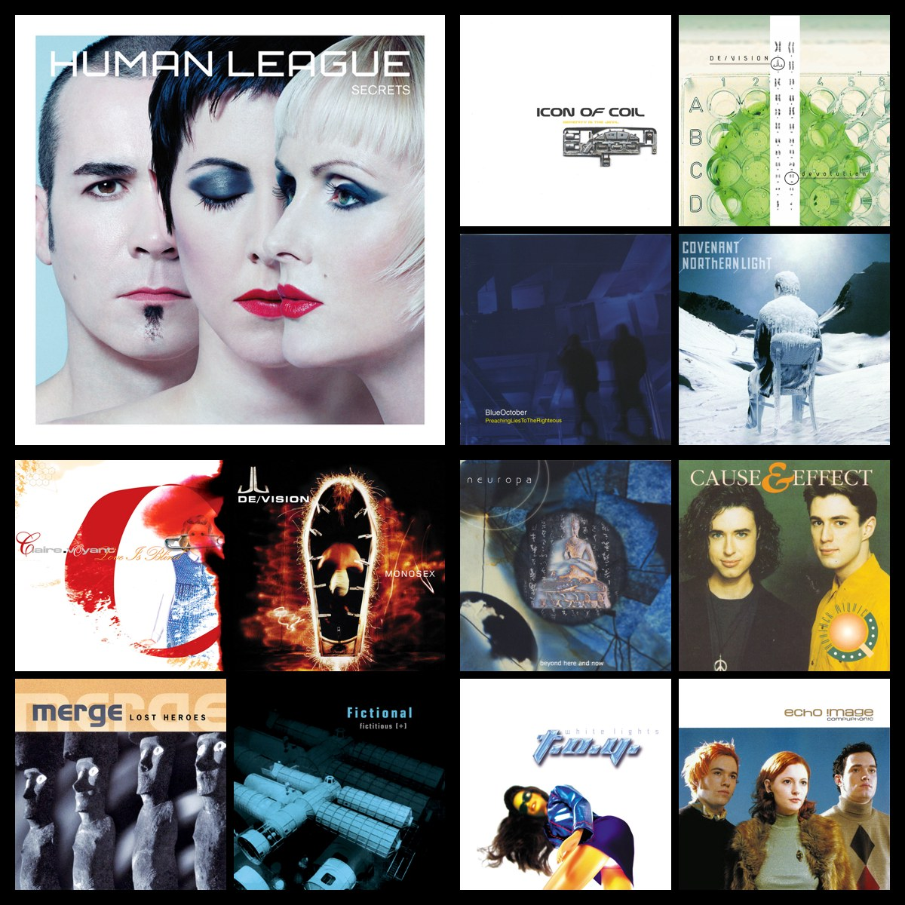
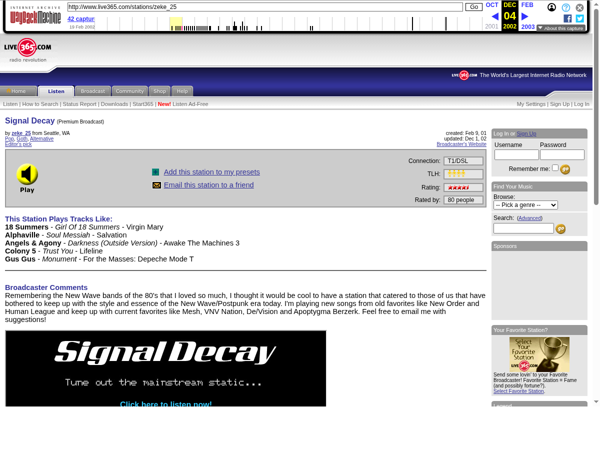
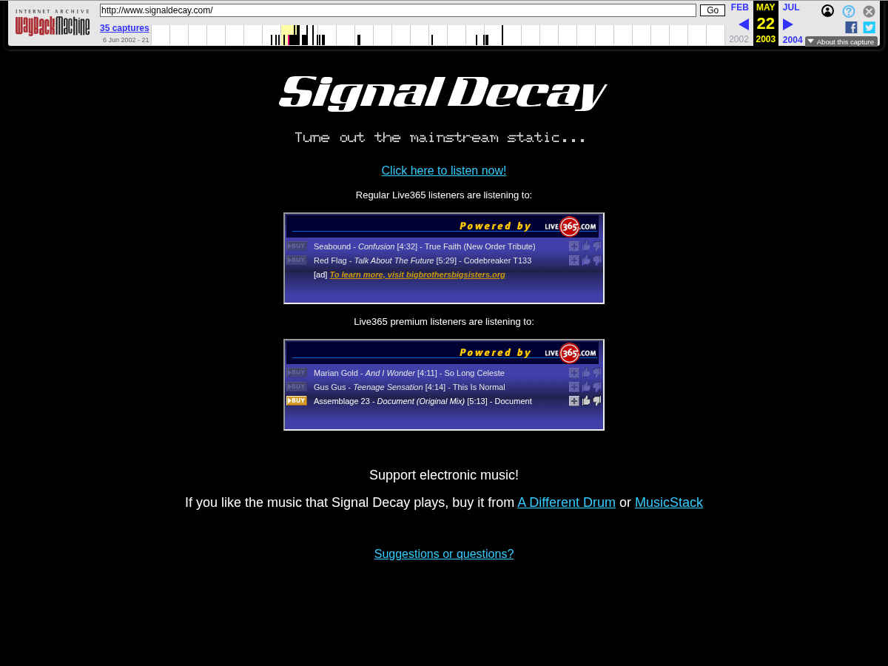
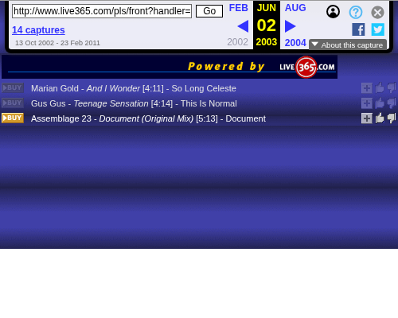
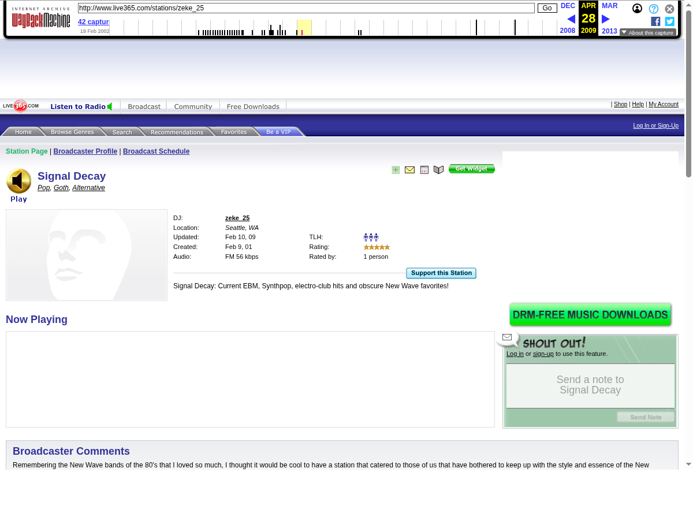
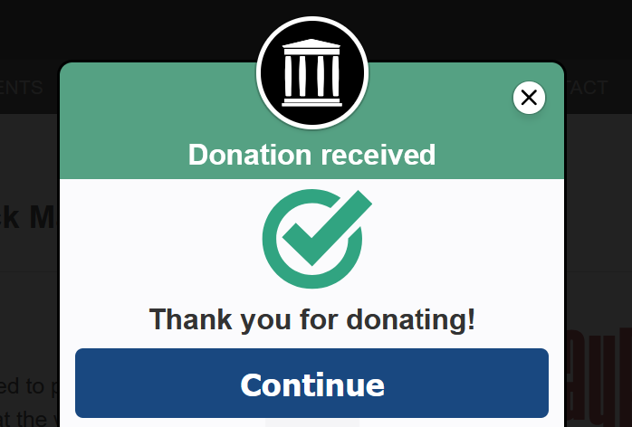

**TL;DR**: Around 2002, I listened to an internet radio station on Live365 called Signal Decay. With no surviving playlists or recordings of my own, I went digging through the Wayback Machine and pieced together 143 tracks from old HTML snapshots, three songs at a time—eventually turning them into [a playable 137-track mixtape](https://mixtapes.lmorchard.com/00-conceptual/signal-decay/).

<!--more-->

<figure class="wide">

<figcaption>
  A mosaic of album covers from the 137 tracks recovered from Signal Decay.
</figcaption>
</figure>

<nav role="navigation" class="table-of-contents"></nav>

Around [2002](https://blog.lmorchard.com/2002/), I spent a lot of time listening to an internet radio station called [Signal Decay on Live365](https://web.archive.org/web/20020219053314/http://www.live365.com/stations/zeke%5F25). It was a source for synthpop, futurepop, EBM, and assorted electronic music: Monolithic, Cosmicity, Neuroactive, Icon of Coil, Stromkern, and others. I loved it, but as is the way with internet radio from that era, one day it was just gone. I have no idea what happened to it. I didn't have a playlist, a stream dump, or any recordings.

I get stuck on this kind of thing, though. Long story short, now I have [a playable Signal Decay inspired mixtape](https://mixtapes.lmorchard.com/00-conceptual/signal-decay/): 137 tracks, reconstructed from the Wayback Machine. Getting there involved an old LiveJournal post, a lot of archived HTML, repeatedly asking whether a few more songs might be hiding in the next capture, and a surprising amount of arguing with search engines about which "Iris" I meant.

If you want to listen while you read, here's [the reconstructed station](https://mixtapes.lmorchard.com/00-conceptual/signal-decay/) by way of my mixtapes project:

<figure>
<iframe style="border-radius:12px;" src="https://mixtapes.lmorchard.com/00-conceptual/signal-decay/embed/" width="100%" height="900" frameBorder="0" allowfullscreen="" allow="autoplay; clipboard-write; encrypted-media; fullscreen; picture-in-picture" loading="lazy"></iframe>
<figcaption>
  The playable Signal Decay reconstruction, embedded from <a href="https://mixtapes.lmorchard.com/00-conceptual/signal-decay/">mixtapes.lmorchard.com</a>.
</figcaption>
</figure>

## Finding the station ruins

A few years ago, I wrote about [Spying on Big Sonic Heaven](/2021/04/26/big-sonic-heaven-spy/), where I set up automated scraping to turn DJ Darren Revell's streaming show into a massive Spotify playlist. Now, it's [also a mixtape](https://mixtapes.lmorchard.com/00-conceptual/big-sonic-heaven-spy/).

But [Big Sonic Heaven](https://www.bigsonicheaven.com/) is an active station. Signal Decay has been dark for over a decade. All I had was a lingering memory of how it sounded and an ADHD rabbit-hole impulse to hear it again.

I've been looking for this station off and on for years. Most recently, I posted about it on [Bluesky](https://bsky.app/profile/lmorchard.com/post/3mrvgu5jxlc2v) and [Mastodon](https://masto.hackers.town/@lmorchard/117011173267473426). But, the most useful starting point was finding [an ancient LiveJournal post I wrote on December 16, 2002](https://deus-x.livejournal.com/193051.html). I linked three internet radio stations, one was Signal Decay:

`http://www.live365.com/stations/zeke_25`

Searching for "Signal Decay" had mostly turned up unrelated things. An exact old URL gave the Wayback Machine something specific to work with. I opened [a December 2002 capture](https://web.archive.org/web/20021204074309/http://www.live365.com/stations/zeke_25) and things looked familiar.

<figure class="wide">

<figcaption>
  Signal Decay on Live365 as captured in December 2002, complete with the broadcaster profile and the five-track sampler box.
</figcaption>
</figure>

The station credited **zeke_25 in Seattle**, listed a creation date of February 9, 2001, and linked to `signaldecay.com`. This domain, of course, no longer leads to a website. Welp.

The broadcaster described wanting to carry the spirit of New Wave and post-punk forward, mixing newer work by older favorites with bands like Mesh, VNV Nation, De/Vision, and Apoptygma Berzerk. That sounded like the station I remembered.

More usefully, the page had a little section labeled "This Station Plays Tracks Like." Five songs. Actual titles and artists. And those five changed between captures.

## Three songs at a time

So I started walking through the snapshots. One page supplied an Icon of Coil track; another supplied Monolithic's "Maxim." Neuroactive's "As If We Didn't Know" and "Play" appeared later. Alongside the names I remembered were plenty I hadn't thought about in years.

This was a job for a bot. So, I threw ChatGPT and Codex at it, [driving a browser on my laptop](https://learn.chatgpt.com/docs/computer-use) to cycle through all the snapshots. Yeah, I know, that's cheating. But, the first run reached 42 distinct tracks. I figured that might be all I could reasonably recover. Then another pass brought it to 90. Checking the later station pages pushed it further.

The next useful discovery was inside the station's own website—dead now, but not way back then. It embedded two small Live365 playlist frames, one for regular listeners and one for premium listeners, each showing the last few tracks played.

<figure class="wide">

<figcaption>
  The signaldecay.com homepage as captured in 2003, featuring side-by-side embedded Live365 frames for standard and premium listeners.
</figcaption>
</figure>

<figure>

<figcaption>
  The isolated Live365 playlist frame for premium listeners (<code>afl:zeke_25</code>), yielding tracks three at a time with exact album titles and timestamps.
</figcaption>
</figure>

Those frames had their own archive histories. Each one was a tiny peephole that only ever showed the last three songs played—which meant this whole recovery was literally happening three songs at a time. Some snapshots overlapped, others showed advertisements or said "playlist unavailable," but following both the regular and premium feeds across different capture dates slowly yielded more music.

By the end, I had **143 distinct track entries, supported by 228 appearances across 57 source groups**.

## What I still don't know

I still don't know the broadcaster's real name. The surviving profile identifies them as zeke_25 and describes a collector with a substantial appetite for synthpop, New Wave, and Front Line Assembly side projects. That's more context than I started with, but it isn't an identification.

Maybe they don't want to be known? I dunno. If you're reading this, hi! I liked your station.

There's also [a Reddit comment claiming hours of recorded Signal Decay streams](https://www.reddit.com/r/synthpop/comments/1kdbd1w/comment/mqb0pa7/). That remains a lead, but I don't know if I feel like bugging a Redditor for their audio stash.

The end date is uncertain, too. An [April 2009 station capture](https://web.archive.org/web/20090428070726/http://www.live365.com/stations/zeke_25) still shows the station as updated in February 2009. Later captures give us unavailable playlists, confusing redirects, and eventually a 404. The original Live365 [shut down in January 2016](https://live365.com/blog/live365-is-officially-back/), but I didn't find evidence that Signal Decay kept broadcasting until then.

<figure class="wide">

<figcaption>
  Signal Decay's Live365 page in April 2009—sporting a mid-2000s redesign and showing its last recorded update from February 2009.
</figcaption>
</figure>

## From a list of names to something you can play

What I did recover was enough to listen again, but a list of names isn't a mixtape. 

I took it into my [mixtapes project](https://mixtapes.lmorchard.com/) and worked with Claude Code to match the tracks - I [wrote a skill to help me](https://github.com/lmorchard/mixtapes.lmorchard.com/tree/main/.claude/skills/new-mixtape) with this sort of thing. That, along with tooling in [byom-sync](https://github.com/lmorchard/byom-sync), matches each track against Spotify for album art and metadata, and against other sources like YouTube and Bandcamp.

Automated matching turns out to be very confident and occasionally hilarious. Iris's "Twilight" matched a 2024 song by IRyS, a VTuber. Espionage's "Perfect Day" resolved to a Bloomberg documentary about a Chinese spy. Glis's "Break Away" turned up as a My Little Pony clip, Monolithic's "Maxim" as a blockchain conference panel, and Wave In Head's "Where I Belong" as Joey Bada$$. Every one of those passed the automated checks, because every field was filled in.

Thankfully, the archived pages also listed album titles for each track. Comparing every match against the respective album helped flag the bad matches.

It also caught subtler misses: a Diary of Dreams track matched to a 2012 re-recording instead of the original, a Merge song matched to a remix, and the reverse case, where the station had actually been playing Conjure One's Ian Van Dahl remix of "Sleep" and the matcher reached for the album version. One artist name needed a correction the other way: the station credited "Shining Star" to Silke Bischoff, but by the time that album came out, the band had renamed itself 18 Summers.

Six of the 143 tracks I couldn't find anywhere playable. That includes all three by Espionage, whose album *Into the Ground* I couldn't find on Spotify or YouTube at all. Those didn't make the playlist, which is how 143 recovered tracks became 137 playable ones.

## Signal less decayed, I guess?

I know this whole thing is a little weird. I didn't actually recover the music itself. There were no stream rips, no abandoned MP3 caches, no dusty cassette tapes recorded off an audio jack.

What I recovered was the DJ's curated choices. 

A stranger in Seattle named `zeke_25`, sitting in a room in 2002 and broadcasting their tunes into the net. They pointed me at music that's stuck in my head to this day. That human taste is what survived in those old HTML tables and playlist frames. It was just enough metadata to let modern streaming APIs re-hydrate the ghost of a radio station into a mixtape.

In thanks to the Wayback Machine for holding onto all those digital breadcrumbs and making this bit of musical archaeology possible, I tossed the Internet Archive a donation. If you get value out of their digital time machine, [consider throwing them a few bucks too](https://archive.org/donate/).

<figure>

<figcaption>
  Tossing a tip to the Internet Archive for holding onto all those bits.
</figcaption>
</figure>
