TL;DR: It's been six weeks, so we're playing catch-up once again. Between work travel that left me longing for a shipping chrysalis, I turned my public bookmarks into a static site, spun up a basement Git forge, survived an October Hellraiser binge, and assembled a Halloween mixtape.

<!--more-->

<nav role="navigation" class="table-of-contents"></nav>

## Spoopy season

This post is a little late for it, but October is always my excuse to wallow in spooky media and gloomy synthpop.

On the music front, I put together a new Halloween mixtape, [*From the Moor to the Crypt*](https://masto.hackers.town/@lmorchard/117442067540160241), packed with gothic rock, darkwave, and synthpop. If you want some seasonal listening while you read:

<iframe style="border-radius:12px;" src="https://mixtapes.lmorchard.com/03-wheel-of-the-year/from-the-moor-to-the-crypt/embed/" width="100%" height="800" frameBorder="0" allowfullscreen="" allow="autoplay; clipboard-write; encrypted-media; fullscreen; picture-in-picture" loading="lazy"></iframe>

I also added a [direct JSPF playlist download link](https://masto.hackers.town/@lmorchard/117497136758365511) to the mixtape site so people can grab the playlists for their own players, and spent a weekend setting up a [Veilamp server](https://masto.hackers.town/@lmorchard/117470132724919398) on my local NAS to stream over peer-to-peer Veilid. 

Earlier in the month, I also [recovered the tracklist of *Signal Decay*](https://blog.lmorchard.com/2026/10/08/signal-decay/), my beloved 2002 Live365 internet radio station, piecing together 137 tracks from Wayback Machine archives into a playable snapshot.

I spent several evenings playing [*CONTROL Resonant*](https://www.remedygames.com/games/control-2), which is delightfully surreal. At one point, you [defeat a cursed karaoke machine with the power of song](https://masto.hackers.town/@lmorchard/117389641777674682), and the game slips in [a subtle Achewood easter egg](https://masto.hackers.town/@lmorchard/117396387402162765) referencing Philippe's "Here Comes a Special Boy" sneakers:

<figure>
<video controls style="max-width: 100%; border-radius: 8px;">
  <source src="control-resonant-special-boy.mp4" type="video/mp4">
</video>
</figure>

From there, I fell headfirst into Clive Barker territory. I picked up *Hellraiser: Revival*, which has [an astonishing ratio of creaky latex mouth noises, body horror, and stray sex toys](https://masto.hackers.town/@lmorchard/117446028092860577). That naturally kicked off a full rewatch of the original *Hellraiser* film franchise. 

Watching *Hellraiser III: Hell on Earth*, starring [Terry Farrell](https://www.imdb.com/name/nm0000395/), I couldn't stop imagining that [the entire movie is actually Jadzia Dax running a thoroughly unhinged holosuite program at Quark's](https://masto.hackers.town/@lmorchard/117545594777054703). 

I also revisited *Repo! The Genetic Opera*, because [Zydrate comes in a little glass vial](https://masto.hackers.town/@lmorchard/117537828450995317).

Speaking of eerie historical habits, I also really dug this CASSIE WORKMAN IS WITCHY AF episode on how [the Victorians were completely obsessed with talking to the dead](https://www.youtube.com/watch?v=VI4rS6hJQt8):

<youtube-embed video-id="VI4rS6hJQt8" thumbnail="e018d1d268a8.jpg"></youtube-embed>

## Gremlins and critters

At home, the cat dynamics have settled into an entertaining rhythm of desk loafing and petty sibling harassment.

Miss Biscuits has embraced her role as a chaotic little gremlin. Whenever Minnaloushe is sleeping peacefully in his elevated desk bed, Miss Biscuits will sneak up from below, stand on her hind legs, and [reach up with one paw to torment him](https://masto.hackers.town/@lmorchard/117395570901402814):

<image-gallery>

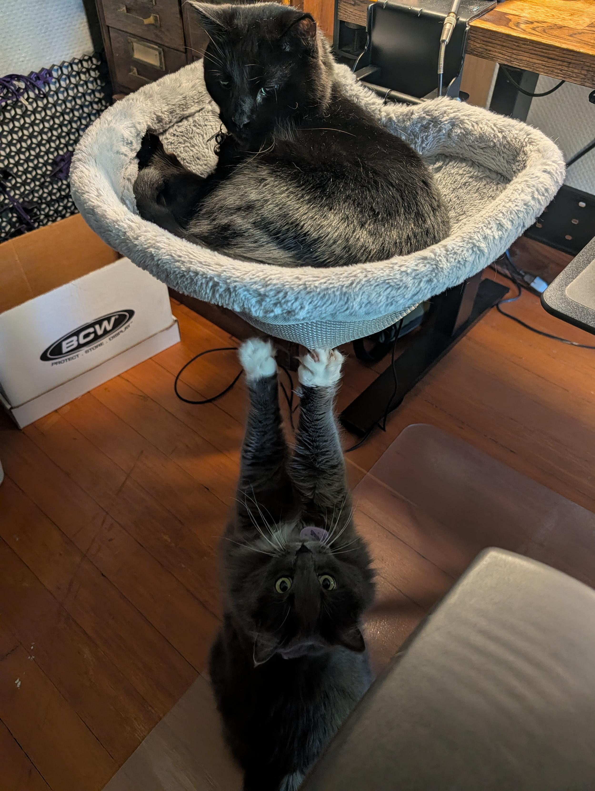

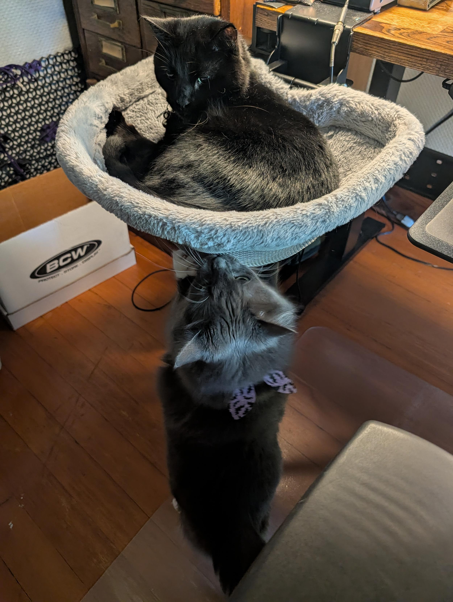

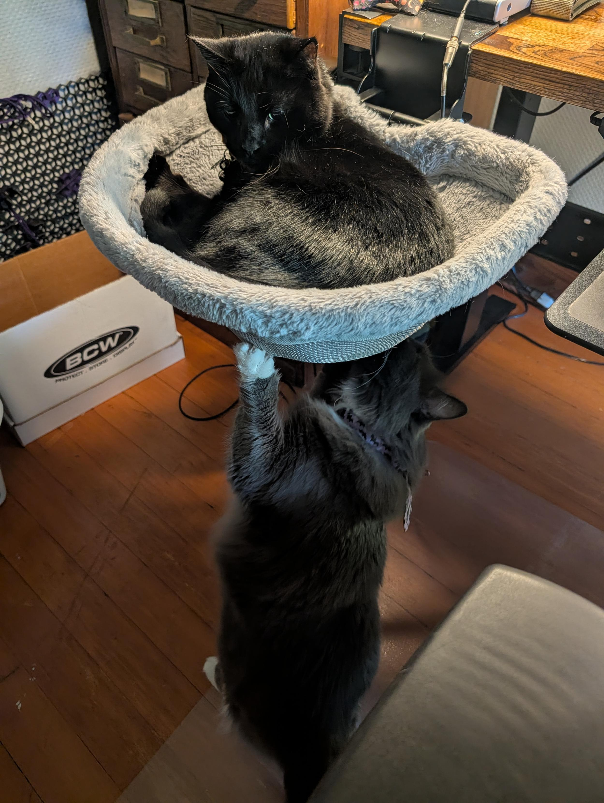

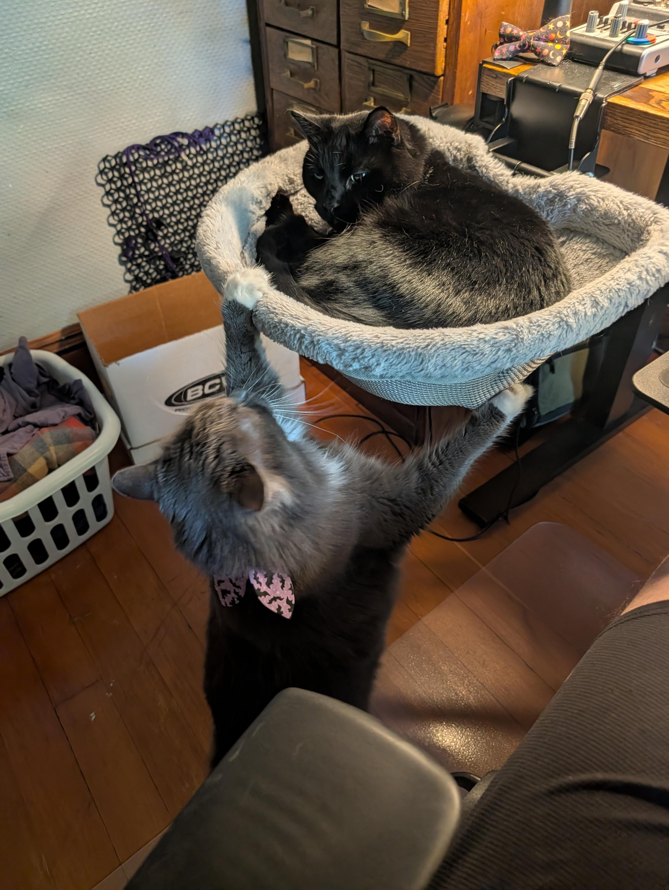

</image-gallery>

Minnaloushe also provided the household's greatest physics demonstration of the month. I let out [a massive, room-shaking sneeze](https://masto.hackers.town/@lmorchard/117396424534348245) at the exact split-second that a garbage truck clattered past outside. Minnaloushe launched three vertical feet into the air like a startled spring and bolted down two flights of stairs in a single blur of black fur. He survived, but dignity was lost.

Outside, the backyard slate garden pond has been trickling along nicely since April, and our doorbell camera caught [a neighborhood raccoon exploring the front porch pumpkins](https://masto.hackers.town/@lmorchard/117431619408687879) before getting utterly spooked by a cast-iron hedgehog boot brush.

On the 3D printing front, after rewatching *Project Hail Mary* with my father-in-law, I [printed Rocky's Grace figurine](https://masto.hackers.town/@lmorchard/117310583815747330), which now guards my laptop keyboard. I also tried printing with ASA filament inside an enclosure, which confirmed my suspicion that [melting technical plastics smells like a bad decision](https://masto.hackers.town/@lmorchard/117451921898548907).

<image-gallery>

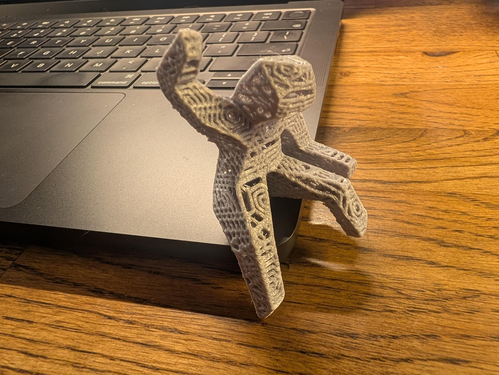

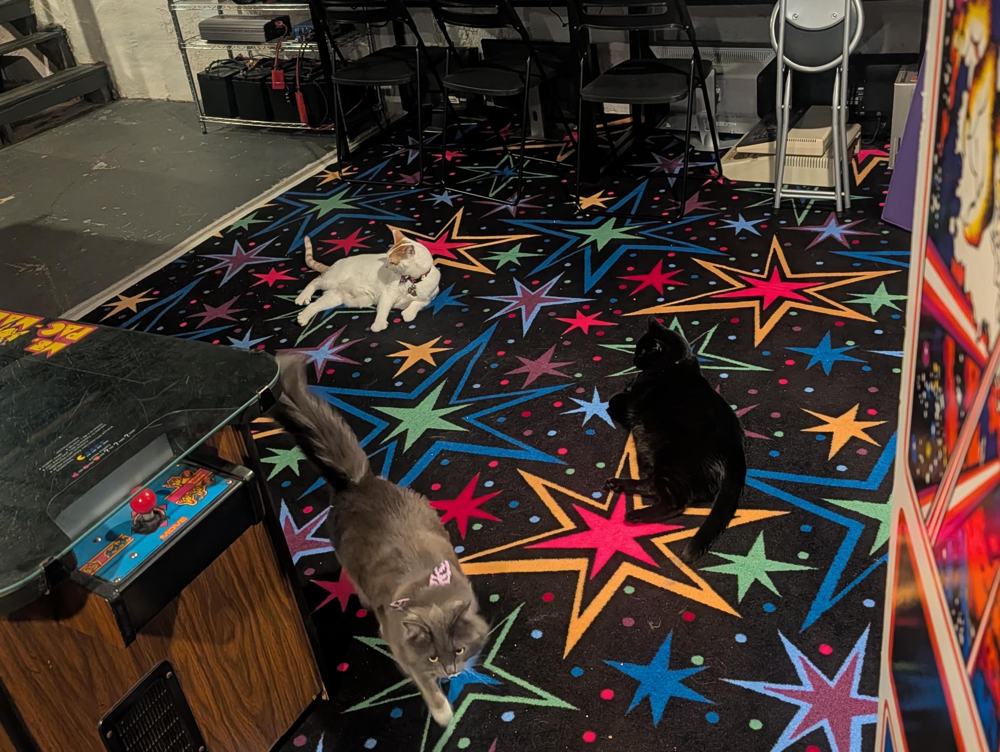

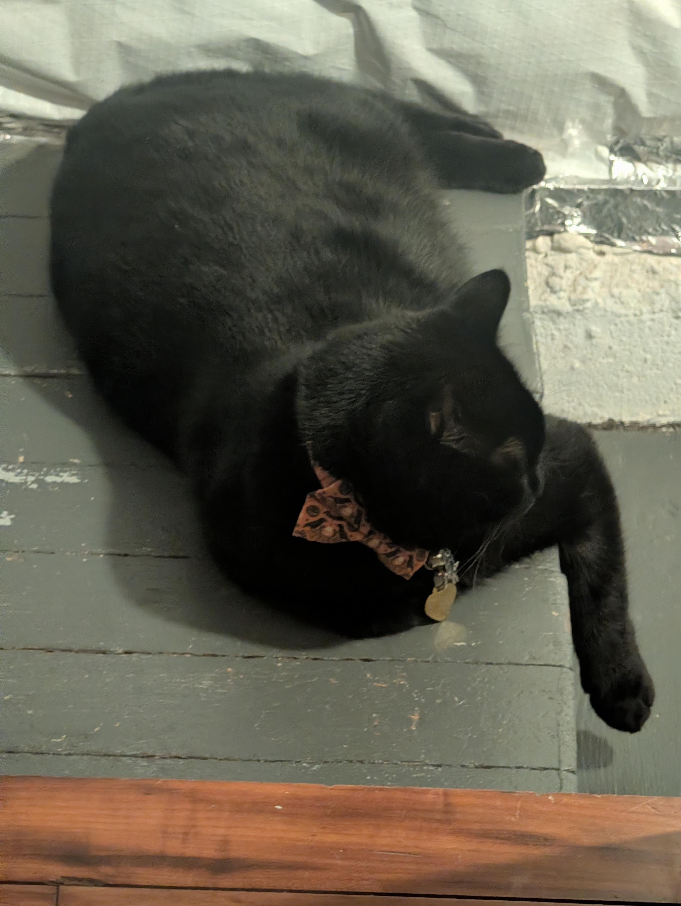

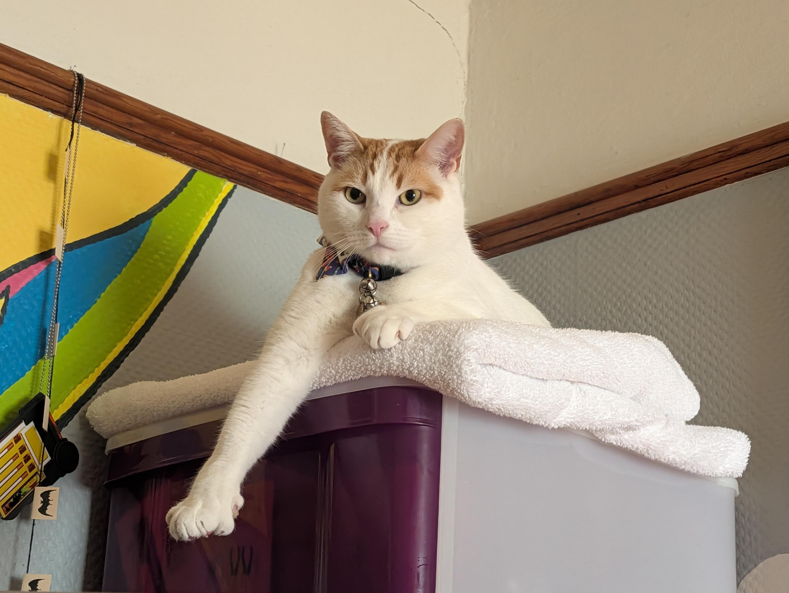

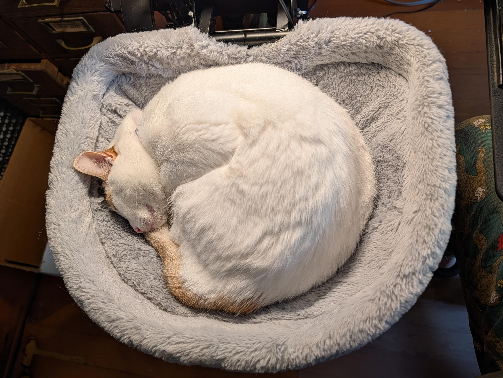

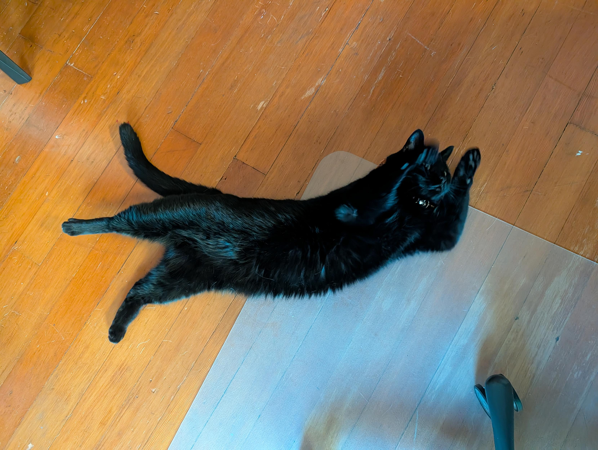

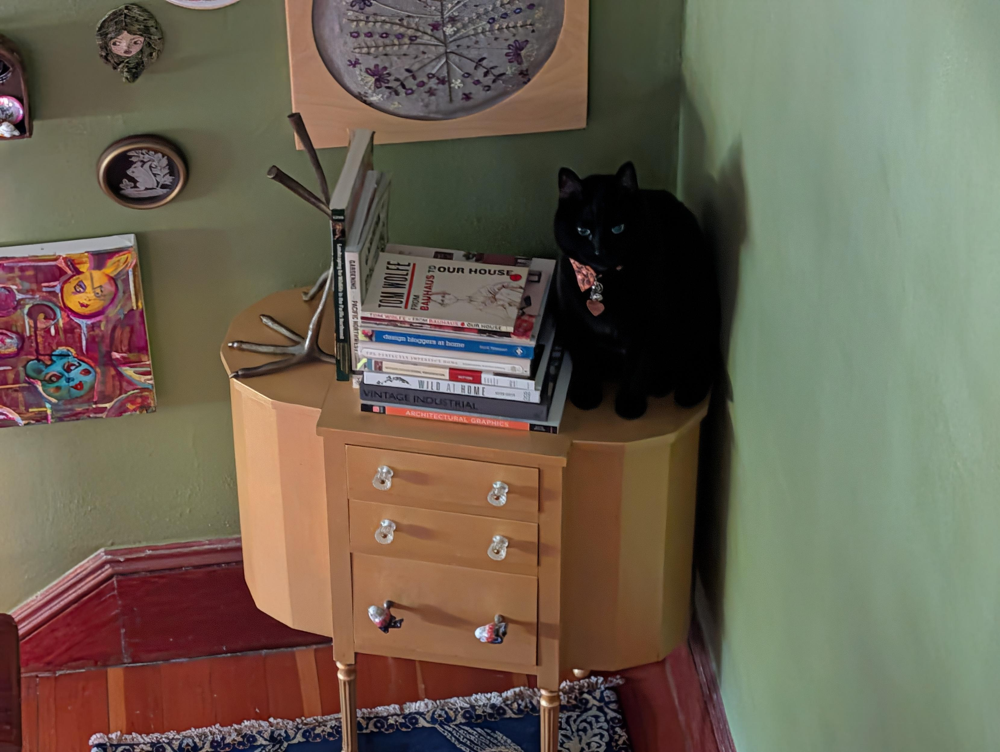

</image-gallery>

## Work travel horrors

Late August, September, and October all brought work trips and flights, which always reminds me how poorly suited my nervous system is for modern air travel. I'm not really cut out to be a jet-setter these days.

I'm not asking for much: I just want to slip into an opaque, soundproof shipping tube or sensory-deprivation chrysalis, drink a warm cup of broth, pass out, and be delivered to my hotel room via freight logistics. 

Instead, air travel is a relentless barrage of overstimulation, forced proximity & touch, and—at least for me as a CPAP user who's never gotten the thing to work on a plane—unavoidable sleep deprivation. 

On my birthday flight, someone opened a container of steaming takeout fish two seats over. I have never been more grateful for an N95 mask. Next flight, I was treated to [a seat neighbor whose entire ass threatened to enfold my arm](https://masto.hackers.town/@lmorchard/117523075626420686) for about 6 hours. At a gate, a gentleman behind me coughed open-mouthed, sounding like a dying Godzilla. On another flight, a couple's breakup fight was conducted at full volume in the row behind me—that was at least a little entertaining, though.

Then there is the hotel experience itself. Why must every hotel lobby and hallway be aggressively bathed in acrid, synthetic stink? Oh, right: [they're doing it on purpose, so they have a signature scent](https://thewishboneway.substack.com/p/the-war-on-hotel-signature-scents). I guess they're pumping that in by the gallon to get through to COVID-deadened olfactory nerves.

By day three, that perfume has soaked into my clothes, my luggage, and my CPAP tubing. It seems to take a few weeks until I stop smelling it on my things. I come home exhausted, [catch a sinus infection](https://masto.hackers.town/@lmorchard/117389645603276839), and spend a week wondering what year it is. 

All of this is to say: I have a lot of anxieties and sensitivities, and my home is tuned just-so to compensate. It would be easier if my system were calibrated differently, maybe to actually enjoy this stuff, but it's always a shock when I'm pulled out of my enclosure.

## Homelab putterings

When I was actually at home and had brain cells to rub together, I spent a lot of time puttering around with my basement homelab.

For years, I've been meaning to set up an [OPNsense router](https://opnsense.org/) for my network. And, I finally did it. I stuck an old PC with dual ethernet ports between the ISP's router and the rest of my LAN. Now I can get a much better grasp on what all the IoT gremlins are doing and see some nifty reports & graphs.

Apropos of that, I've also been poking at Grafana and Prometheus, pulling together all kinds of homelab and household data sources into dashboards and monitors. More a learning project than practical, but it's kind of neat to see Home Assistant, web hosting, and AI agent usage stats all in the same place. 

What else? Oh yeah: For a while, I've run [Linkding](https://linkding.link/) in my homelab and reverse-proxied it to the public internet over Tailscale so people could browse my bookmarks. But exposing a dynamic Django application to web traffic just to serve 35,000 read-only bookmarks started feeling deeply silly. So I wrote [linkding-ssg](https://github.com/lmorchard/linkding-ssg), a standalone Go tool that pulls bookmarks from the REST API and renders out a static site with client-side Pagefind search. I [wrote up a full post about it](https://blog.lmorchard.com/2026/11/01/linkding-ssg/).

Along similar lines, I [spun up a Forgejo instance](https://masto.hackers.town/@lmorchard/117487346078056428) in my basement and set it up to mirror all my GitHub repositories. Setting up Forgejo was delightfully painless—just a clean binary, SQLite, and a minimal config file.

I also kept chipping away at [DecafClaw](https://github.com/lmorchard/decafclaw), overhauling its asynchronous turn scheduling, building structural workspace outlines, and giving tool outputs rich data-table and code-block widgets.

## Miscellanea

* We lost two giants this month: [Margaret Hamilton](https://news.mit.edu/2026/margaret-hamilton-computing-pioneer-dies-1007), the Apollo computing pioneer who led the software team that put humanity on the moon, passed away at 90. And [Sir Patrick Stewart](https://masto.hackers.town/@lmorchard/117526037751989940) passed away, leaving behind a legacy that defined what quiet, thoughtful leadership looked like for an entire generation of nerds.

  

* And for Star Trek editing madness: [All the Percent - A Star Trek: TNG Supercut](https://www.youtube.com/watch?v=YEaicg1kYMk), compiling every spoken percentage in the entire series:

  <youtube-embed video-id="YEaicg1kYMk" thumbnail="32d1cf19ef6f.jpg"></youtube-embed>

* [Controlling your home with tiny, cheap touchscreens](https://a.wholelottanothing.org/controlling-your-home-with-tiny-cheap-touchscreens/?ref=a-whole-lotta-nothing-newsletter) - An inspiring build using $16 ESP32 touchscreens for simple, dedicated room controls. I've got a few of these on order from Aliexpress right now. I kind of want to set up some LCARS-style control panels around the house.

* Someone built an MP3 player that only plays through car tape decks, and it is glorious retro-hardware absurdity:

  <youtube-embed video-id="otXrFBq0HWQ" thumbnail="89780268f78e.jpg"></youtube-embed>

* Speaking of unusual vehicles: I enjoyed watching [the build of the legendary Mazda Suitcase Car](https://www.youtube.com/watch?v=rpV4phLQsE4), a functioning three-wheeled micro-car built directly into Samsonite luggage:

  <youtube-embed video-id="rpV4phLQsE4" thumbnail="199bd03bdecc.jpg"></youtube-embed>

* I also loved this retrospective on [The Story of THE ADVENTURES OF BUCKAROO BANZAI (1984) & the Franchise That Never Was](https://www.youtube.com/watch?v=E6eHGA_bQfk):

  <youtube-embed video-id="E6eHGA_bQfk" thumbnail="8c47c199bc20.jpg"></youtube-embed>

* [I don't like LLMs](https://martinfowler.com/articles/2026-dont-like-llms.html) - Martin Fowler on why interacting with an LLM that poses as a faux-human feels so viscerally off-putting — basically, why would you voluntarily talk to someone whose conversational style you'd cross the street to avoid?

* Software craft: [What I believe about the future of software development](https://thorstenball.com/blog/2026/09/19/what-i-believe-about-the-future-of-software-development/) by Thorsten Ball, [Grieving the loss of details](https://purplesyringa.moe/blog/grieving-the-loss-of-details/?ref=sidebar) on how automated vectorization and LLM shortcuts erode the joy of deep technical understanding, and [A new model for open source: closed to pull requests, open to remix](https://ghuntley.com/remix/).

* Retro computing rabbit holes: [Anil Dash on how to install an app on your Commodore 64](https://www.anildash.com/2026/10/08/install-an-app-commodore-64/), running [Metal Gear Solid natively on an ESP32-S3](https://velxio.dev/blog/posts/metal-gear-solid-on-esp32-s3/), and [Decent400](https://hackaday.io/project/206854-decent400?mc_cid=9785804ef8), a drop-in mechanical keyboard replacement for the Atari 400's membrane keys.

* Web architecture: [Why don't more developers "use the platform"?](https://nolanlawson.com/2026/10/03/why-dont-more-developers-use-the-platform/) and [Do web components have a future if nobody is writing them?](https://nolanlawson.com/2026/10/19/do-web-components-have-a-future-if-nobody-is-writing-them/) both by Nolan Lawson, tackling the tension between framework bloat and browser standards.

* [Reddit to Remove RSS](https://mjtsai.com/blog/2026/10/06/reddit-to-remove-rss/) - Reddit is pulling the plug on RSS feeds under the banner of combating scraping, continuing the slow, hostile walling-off of the open web. That, and/or the gradual enshittification of Reddit itself.

* [tinylittleoffice](https://github.com/aboard-io/tinylittleoffice) - A clever serverless office suite where your entire document is compressed and encoded right into the URL hash, with no accounts or server storage required.

* [cursory](https://github.com/Vinyzu/cursory) - An open-source tool for generating human-realistic mouse trajectories with authentic timing and bezier curves. It's kind of spooky. And I'm not sure I like that we have tools like that to spoof human motion.

* [Dining Like Darwin](https://www.npr.org/sections/thesalt/2015/08/12/430075644/dining-like-darwin-when-scientists-swallow-their-subjects) - A weird and delightful historical reflection on Charles Darwin's Glutton Club and his insistence on eating his zoological specimens (including puma, which he described as "remarkably like veal").

Anyway, that's what caught my eye and kept my hands busy over the last month and a half. Hopefully I'll manage the next one on something a little closer to an actual weekly schedule. But, probably not. 
