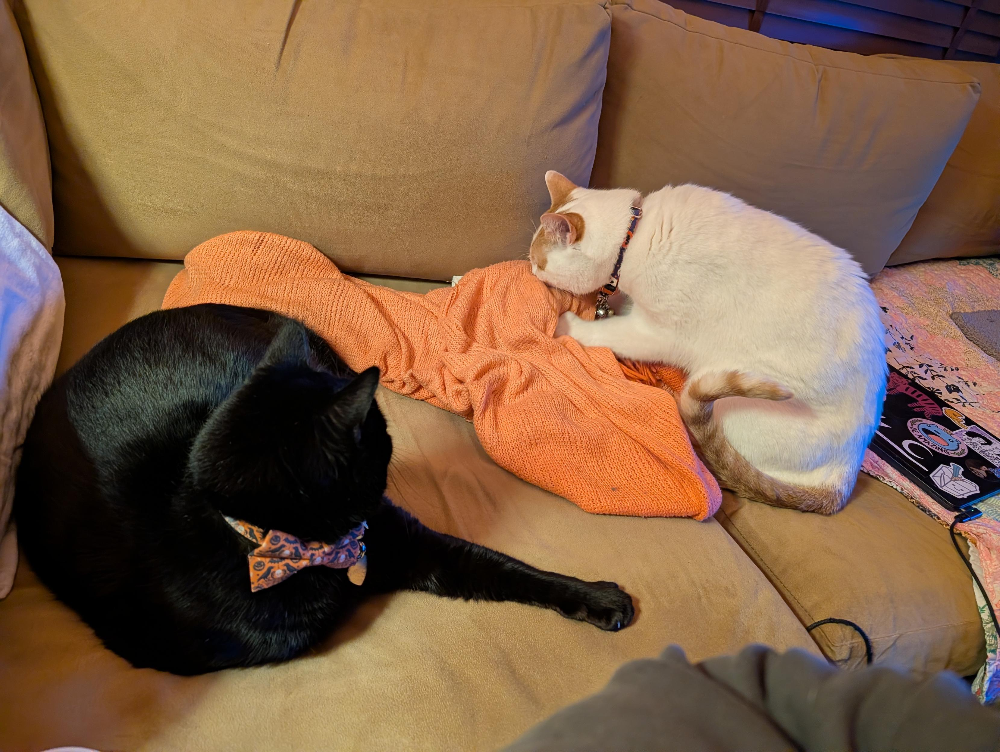
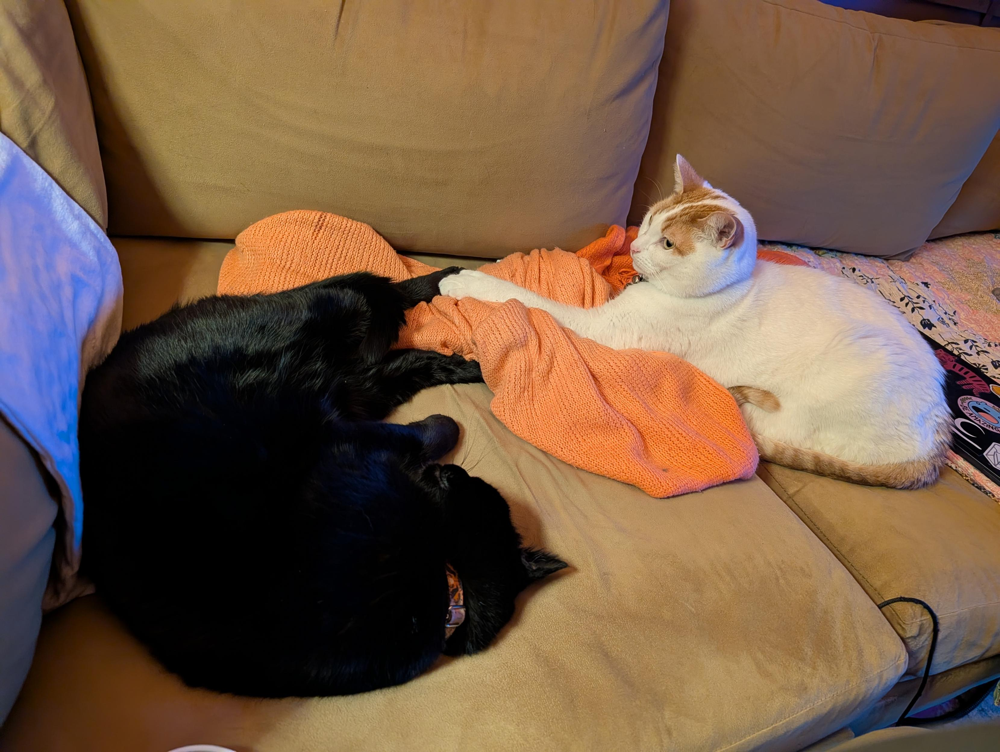
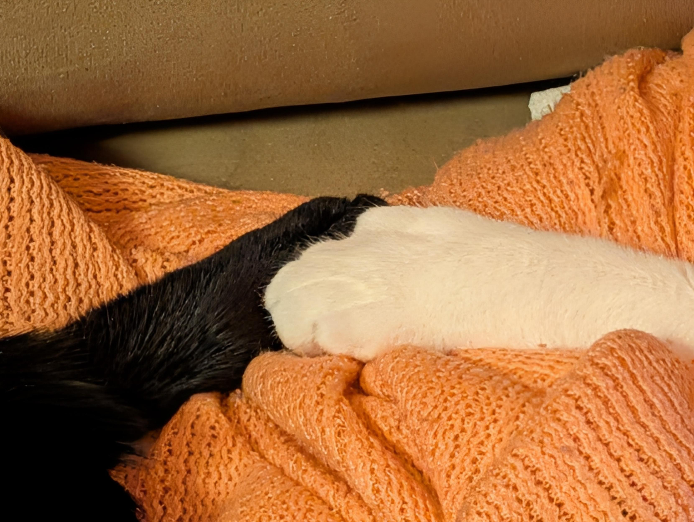
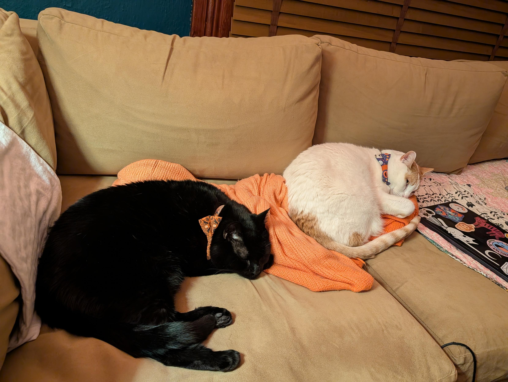
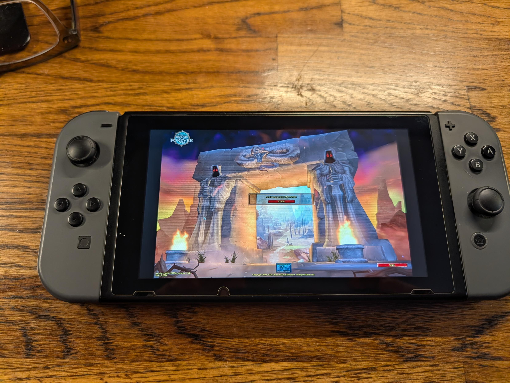
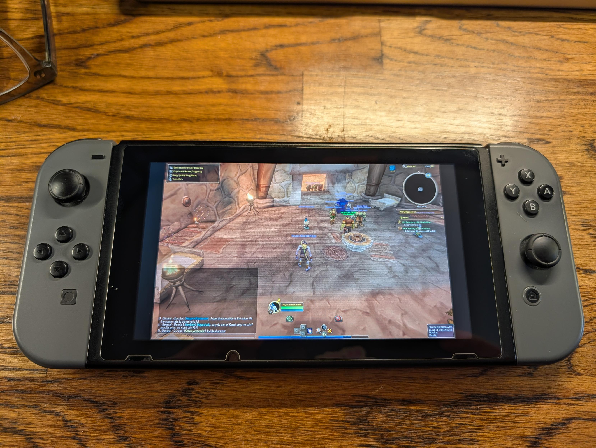
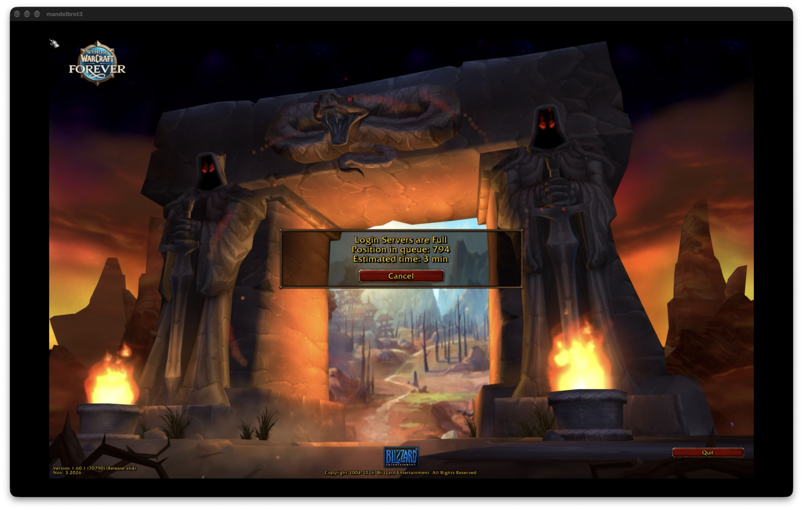
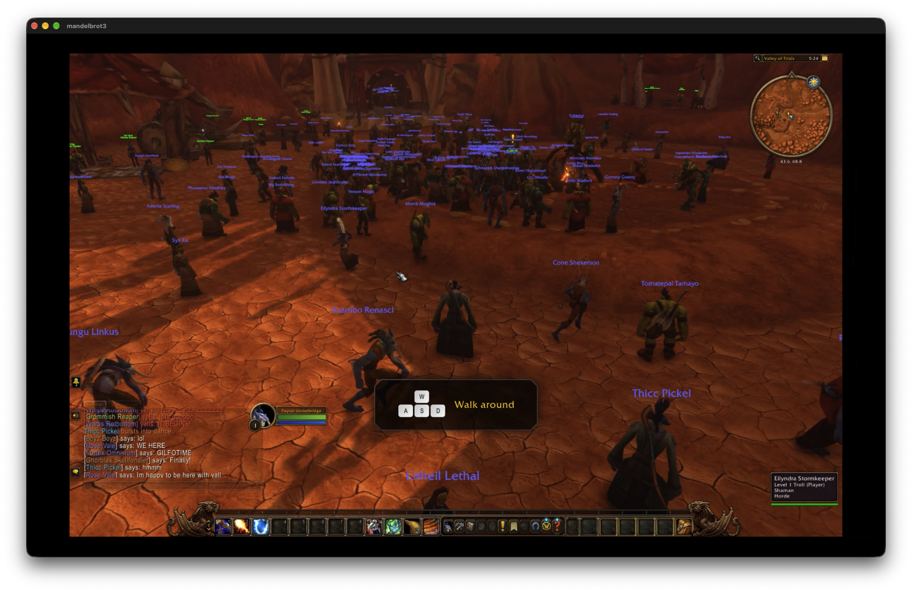
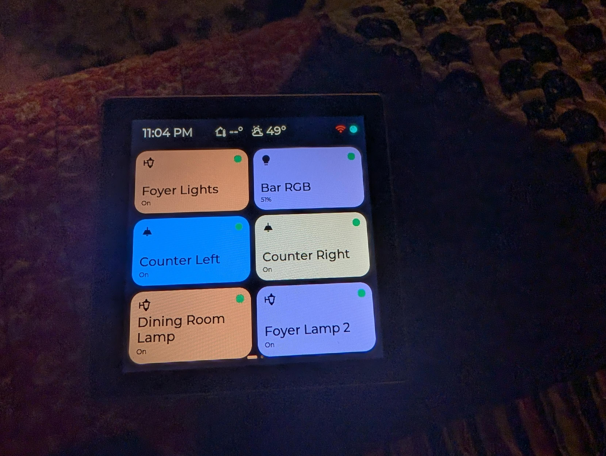
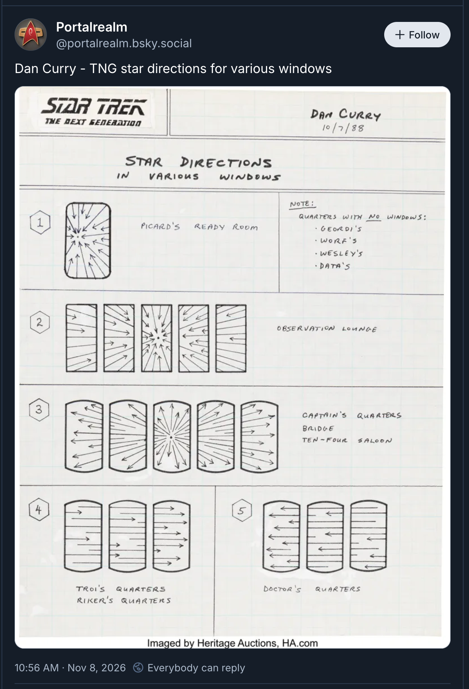

TL;DR: It's been nearly two weeks since the last post, and between streaming WoW Forever to a paperclip-jailbroken Nintendo Switch on the couch, I turned a $16 ESP32 touchscreen into a Star Trek wall panel, untangled a homelab Docker subnet collision that broke Path MTU Discovery, and a bunch of other miscellaneous stuff.

<!--more-->

<nav role="navigation" class="table-of-contents"></nav>

## Paw peace

At home, our resident cat frenemies, Minnaloushe and Cosmo, achieved a rare diplomatic breakthrough this week: [actual, peaceful paw contact](https://masto.hackers.town/@lmorchard/117551291335116520) without claws, hissing, or swiping.

<image-gallery>

</image-gallery>

They spent the better part of an evening [resting in close quarters](https://masto.hackers.town/@lmorchard/117551297392607750), proving that peaceful coexistence is possible when both parties agree that sleeping is superior to violence.

## Pond bandits again

Outside in the backyard, our night camera caught [a pair of neighborhood raccoons exploring the slate garden pond](https://masto.hackers.town/@lmorchard/117610050979410272). They were utterly fascinated by the little water fountain, which they methodically [disassembled and dragged around](https://masto.hackers.town/@lmorchard/117610076525939123) in pursuit of a floating leaf:

<figure>
<video controls style="max-width: 100%; border-radius: 8px;">
  <source src="raccoon-pond-fountain.mp4" type="video/mp4">
</video>
</figure>

## Paperclip exploits

Back in August, after thirteen years of having a bulky, noisy gaming tower squatting behind the couch, I finally [banished the gaming PC to the basement](https://blog.lmorchard.com/2026/08/28/w35/). Getting rid of the heat, fan noise, and snake pit of cables from the living room has been great. With [Sunshine](https://github.com/LizardByte/Sunshine) running headless down there, I can stream games over our local network at full fidelity without hearing a single fan spin up like a jet engine.

This week, that setup reached a new peak: Because I have an unpatched launch-model Nintendo Switch with [the original Tegra hardware flaw](https://www.youtube.com/watch?v=xQmN-cxg21M), I was able to [jailbreak it using a paperclip and a 3D-printed RCM jig](https://masto.hackers.town/@lmorchard/117571363422803304). 

<youtube-embed video-id="xQmN-cxg21M" thumbnail="4ea72c7e6205.jpg"></youtube-embed>

Ten minutes later, I had Moonlight running on the handheld, [beaming desktop games straight to the couch](https://masto.hackers.town/@lmorchard/117571087454975135):

<image-gallery>

</image-gallery>

## WoW again forever

What did I use this triumph of local networking and console exploitation to play? *World of Warcraft Forever*, of course.

I'd started bingeing this new edition of WoW on launch day, back on the 4th, staring down [massive thousand-person login queues](https://masto.hackers.town/@lmorchard/117560709777390285) alongside everyone else who wanted to relive 2004:

Once I actually made it into the game, the starter zones were [a scene of utter carnage](https://masto.hackers.town/@lmorchard/117560755342270756). Hundreds of fresh level-one characters were swarming every boar and scorpid spawn in the Valley of Trials, turning the red dirt into [a carpet of freshly tagged beast corpses](https://masto.hackers.town/@lmorchard/117561136622617926). 

Modern WoW's native gamepad support is shockingly usable. Wandering around Durotar with an analog stick and bumper buttons turns an ancient click-and-wait MMO into a [relaxed couch action game](https://masto.hackers.town/@lmorchard/117570979250715295). 

I couldn't stop myself from [rolling a sprawling army of punny alts](https://masto.hackers.town/@lmorchard/117579676808962615), including Paytol Underbridge (troll mage), Tyllamuk Cheesebrick (tauren druid), Butch Punchbeef (tauren shaman), and Brent Felfondler (undead warlock). 

<image-gallery>

</image-gallery>

I usually prefer solitary play, these days. But there was an unexpected, cozy vibe to [spontaneous group invites and emote chatter](https://masto.hackers.town/@lmorchard/117565120762413767) while wandering through the Barrens. Folks are being surprisingly chill and nice, so far.

Beyond WoW, I think I'm going through a phase right now: I've spent my non-gaming hours [pickling my brain in fantasy MMO media](https://masto.hackers.town/@lmorchard/117600098170553740)—snarfing Matt Dinniman's *Dungeon Crawler Carl* audiobooks, the gamer-meme dub of *Overgeared*, and checking out *Magic Repo Man*. I guess my brain's in the mood for the comfort of visible progression systems and quest logs lately.

## Starship Assistant

A while back, I bookmarked a project on [controlling your home with tiny, cheap touchscreens](https://a.wholelottanothing.org/controlling-your-home-with-tiny-cheap-touchscreens/?ref=a-whole-lotta-nothing-newsletter). One of those $16 ESP32 display boards arrived from AliExpress this week, and I immediately fell down a rabbit hole turning it into a dedicated physical control switch.

I forked [Tessera](https://github.com/cruftbox/tessera) and wired the display up to Home Assistant. Then I paired it with an [LCARS theme](https://github.com/th3jesta/ha-lcars), and suddenly I had [a tactile Starfleet control console sitting on my desk](https://masto.hackers.town/@lmorchard/117585223765107374), letting me toggle lights and scenes with glowing orange and purple rounded chiclets:

<figure>
<video controls loop muted playsinline style="max-width: 100%; border-radius: 8px;">
  <source src="esp32-lcars-screensaver.mp4" type="video/mp4">
</video>
</figure>

It was surprisingly easy and I didn't even have to crack open the case. Just flashed over USB-C after an hour or so of tinkering, and it was talking to Home Assistant.

Naturally, this kicked off a powerful urge to install ESP32 touch panels in every room of the house. That spiraled into [daydreaming about scavenged laptop LCDs](https://masto.hackers.town/@lmorchard/117588286919599519): picking up cracked-case machines from Free Geek, gutting the screens, and building framed ambient starship windows displaying slowly rotating planetscapes or looping shuttle bay feeds:

<image-gallery>

</image-gallery>

## SSH-enabled appliances
 
Meanwhile, in the realm of existing household hardware, I spent an afternoon reading about [flashing local "No Longer Evil" firmware onto an ancient Nest thermostat](https://masto.hackers.town/@lmorchard/117607912897742846) to rip it free from Google's cloud. 

I found a section in the docs talking about SSH access to the thermostat. That triggered a mild bout of [future shock](https://masto.hackers.town/@lmorchard/117607923647499627). 

In college, our entire computer science department shared a single Unix machine. Today, a discarded thermostat glued to my plaster has an order of magnitude more RAM, storage, and CPU cycles than that machine did—and apparently I'll be able to open a shell on it from my laptop once I get it flashed. That'll be a project for this weekend.

## Tailscale MTU mysteries

Speaking of basement networking: I lost a few hours this week to one of the most diabolical network debugging mysteries I've encountered in years.

Tailscale on my primary Synology NAS abruptly stopped working. Any `tailscale up` command hung indefinitely, spitting out control-plane handshake timeouts, even though a manual `curl` to the exact same HTTPS endpoint worked without breaking a sweat.

Tinkering with diagnostic flags, I discovered that setting `GODEBUG=tlsmlkem=0` restored connectivity. Disabling ML-KEM (the post-quantum TLS key exchange) allowed the handshake to sail through cleanly. At first, that looked like ISP fuckery—maybe an intermediate router or firewall bug choking on larger cryptographic cipher suites.

Still digging, I ran side-by-side packet captures against a Linux VM on my network and noticed that both machines were sending initial 1500-byte IP packets during the TLS exchange. Both packets hit the ISP gateway router at `192.168.0.1`, which duly returned an ICMP "fragmentation needed" packet specifying an MTU of 1492. The Linux VM received the ICMP message, resized its packets, and connected. The NAS completely ignored the error and timed out.

Why was the NAS dropping ICMP packets from its own default gateway? 

After spending a long while further tearing apart my entire homelab stack, I realized: A few days earlier, a Docker Compose stack for Speedtest Tracker on the NAS had automatically provisioned a bridge network on `192.168.0.0/20` and assigned its internal bridge interface `192.168.0.1`—the exact IP address of my actual router!

Linux drops incoming packets whose source IP matches a local interface address as a fundamental spoofing defense. So every time the ISP router tried to tell the NAS to shrink its MTU, the kernel dropped the packet on the floor, completely breaking Path MTU Discovery (PMTUD). Disabling ML-KEM had only masked the issue because smaller handshakes squeezed under the 1492-byte limit without fragmenting. Pinning the container to a dedicated `172.29.64.0/24` subnet instantly restored native PMTUD and default post-quantum TLS.

Whew. Funny part is, I barely knew what PMTUD or ML-KEM were before this week. That rabbit hole went deep for something so dumb.

## Miscellanea

* [Executable Emoji](https://martypc.blogspot.com/2026/08/executable-emoji.html) - A wild deep dive into x86 assembly by the author of MartyPC. Because the Intel 8088 decodes the four-byte UTF-8 emoji prefix `F0 9F` as harmless `LOCK` and `LAHF` instruction prefixes, you can construct functional MS-DOS `.COM` executables written entirely in displayable emoji graphemes.

* [Vintagetek Demo Board](https://vintagetek.org/vintagetek-demo-board/) - A custom firmware and hardware board from vintageTEK that generates analog XY deflection voltages to render vector graphics, interactive Lunar Lander, and Tennis directly on vintage Tektronix oscilloscope CRTs without causing phosphor burn-in.

* [The Last Technical Interview](https://yegge.ai/essays/the-last-technical-interview/) - Steve Yegge's critique of the broken 50-year-old engineering interview loop. He's right about the coin-flip randomness of algorithmic trivia, but his proposed solution—provisional "try-before-you-buy" trial periods—feels like an insidious shift of corporate hiring risk directly onto senior workers who have mortgages and families and lack social safety nets.

* [*sshole](https://sshhole.com/) - The actual, very real OpenSSH vulnerability on musl libc systems (like Alpine Linux), where passwords exceeding 256 characters matched musl's defensive `*` error return value and unlocked disabled accounts.

* [Terminal2Shell](https://terminal2shell.com/) - A delightful parody of the branded vulnerability industrial complex, complete with a dramatic logo, warning of an unpatched 55-year-old zero-day flaw where Unix terminals execute arbitrary commands typed by users.

* [My game plays itself so I don't have to](https://remvst.substack.com/p/my-game-plays-itself-so-i-dont-have) - Rémi Vansteelandt on turning an arcade-style AI attract mode into a headless, automated balance and QA engine running full campaigns at high speed in terminal CI.

* [Nobody asked for the sparkle button](https://uxdesign.cc/nobody-asked-for-the-sparkle-button-ae54ab5065c6) - Jon Sabutis tracing how the AI sparkle icon took over software interfaces without anyone explicitly asking for it, and why forcing conversational chat panels into every tool erodes user trust.

* [navikt/mlx-workspace](https://github.com/navikt/mlx-workspace) - A toolkit for running open-weight LLMs locally on Apple Silicon unified memory with MLX, letting developers hook AI coding tools into local endpoints with zero cloud calls.

* [Spreading Liquid with three.js](https://mofu-dev.com/en/blog/fluid-foundation/) - A clever technique using 2D fluid velocity maps, height map frame buffers, and normal shading to simulate viscous spreading cosmetics without moving 3D mesh vertices.

* [I discovered a sound that leaks your exact location](https://www.youtube.com/watch?v=UytYrhYLOKI) - Colsto demonstrates how inaudible background Doppler shifts from overhead aircraft can geolocate an ordinary audio recording within 100 meters:

  <youtube-embed video-id="UytYrhYLOKI" thumbnail="6d8040806c94.jpg"></youtube-embed>

* [Henry Fool - Eye story](https://www.youtube.com/watch?v=0aaW_VMMa2E) - That classic, wonderfully bizarre Hal Hartley scene resurfacing in memory:

  <youtube-embed video-id="0aaW_VMMa2E" thumbnail="49bf4e337125.jpg"></youtube-embed>

* [Why I Run 2–4 GB AI Models 24/7](https://www.youtube.com/watch?v=9LkxI2H3gI0) - A solid look at the quiet utility of small, dedicated local models handling ambient background tasks without melting your power bill:

  <youtube-embed video-id="9LkxI2H3gI0" thumbnail="ff6a7b1eb35e.jpg"></youtube-embed>

* On the music stereo this week: plenty of darkwave, synthpop, and EBM on heavy rotation, including [Covenant](https://open.spotify.com/artist/11zG3SH7tJ36wYmCJ2oWyB), [Mesh](https://open.spotify.com/artist/1uS4cYRRZRtauASIM9RxBG), [ACTORS](https://open.spotify.com/artist/2Gs4t6zBT69DSluLvaEBWK), [Cold Cave](https://open.spotify.com/artist/1ssulsHf3JrWakLxa8yFad), [Priest](https://open.spotify.com/artist/6niO7WSbw5n0nD58jPi2Mx), and an unexpected blast of [100 gecs](https://open.spotify.com/artist/6PfSUFtkMVoDkx4MQkzOi3).

And that brings us up to date. Next up: more couch gaming, more LCARS panels, and hopefully fewer Docker containers attempting identity theft against my home gateway router.
