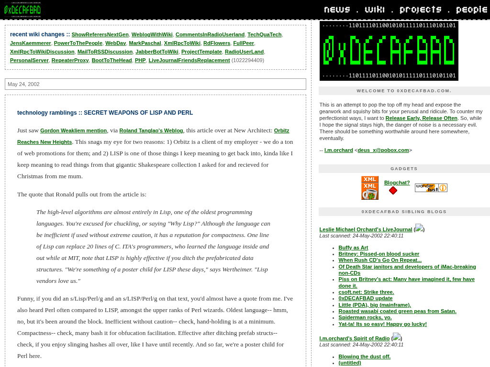
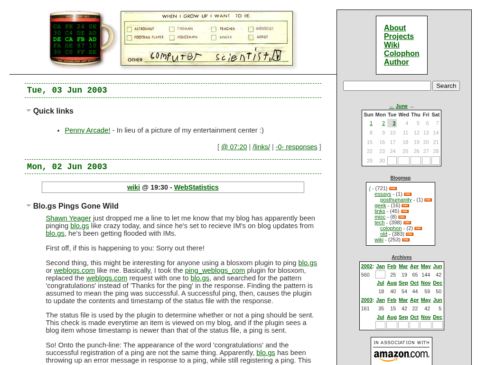
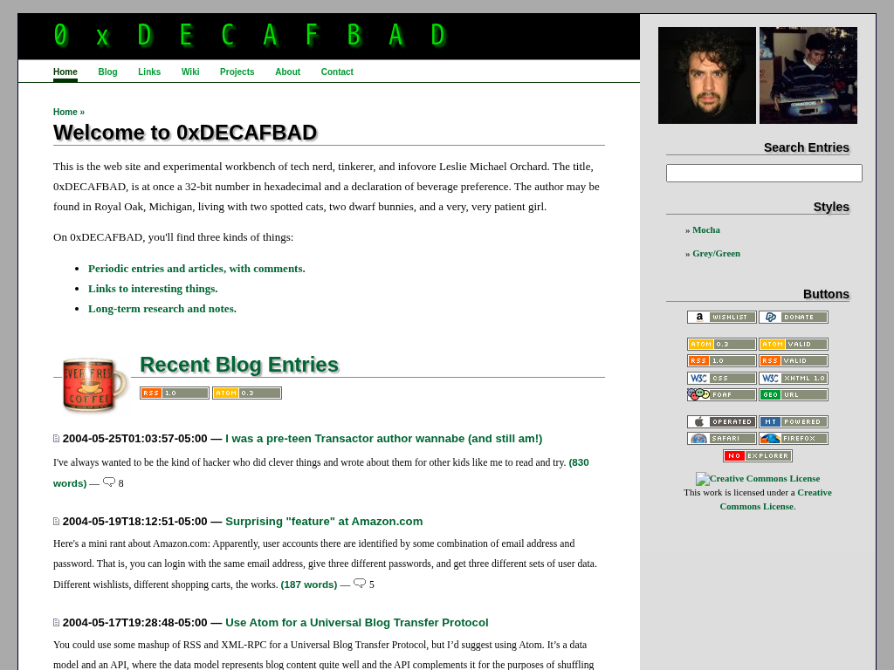
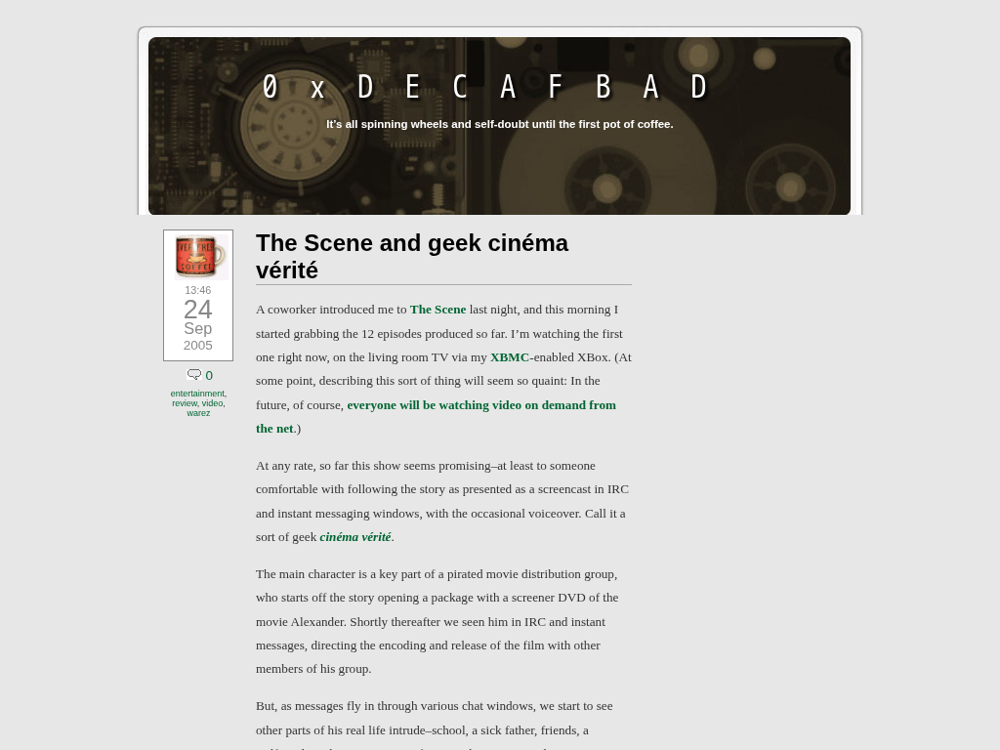
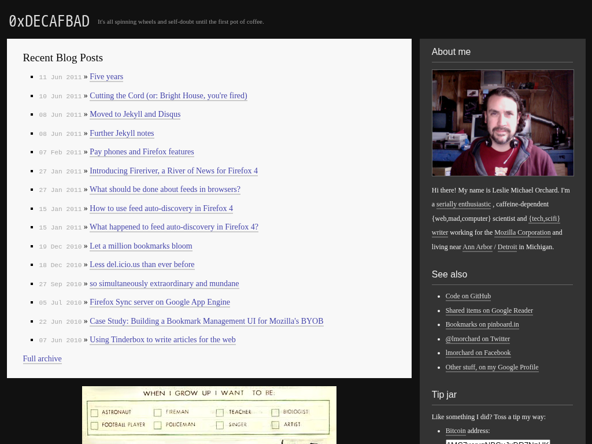
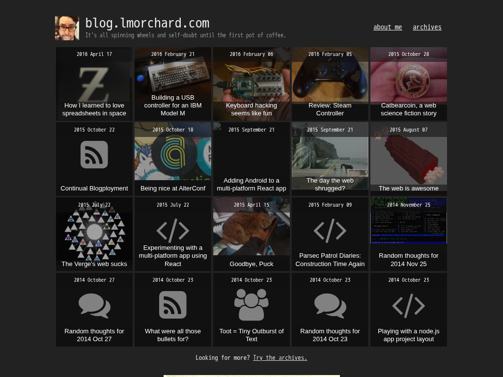
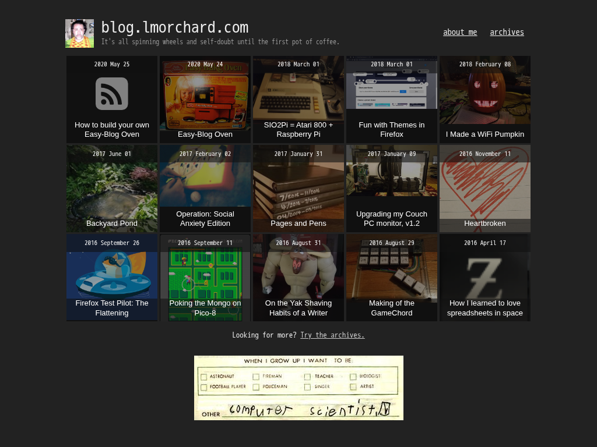

**TL;DR**: After six years of brooding and Dependabot alert fatigue, I finally rebuilt my blog's static site generator in Go. Easy-Blog Oven v2.0 renders twenty-four years of Markdown into HTML in under three seconds, ditches `node_modules` entirely, and was built in an afternoon of flow pair-programming with DecafClaw, my homemade agent project.

<!--more-->

<nav role="navigation" class="table-of-contents"></nav>

## The Six-Year Itch (and the Twenty-Four-Year Continuum)

I have a bit of a history with custom blogging setups. Webdevs generally do, it's a hazard of the profession. But, I'm a rather old webdev, so I might have more history than most.

I didn't start this blog on a static generator. I launched `0xDECAFBAD` in [February 2002 on Movable Type](/2002/02/14/ooooac/). Just 3 months shy of 25 years ago, which makes me a bit dizzy to think about. That's literally half my life ago.

<figure>
  
  <figcaption>0xDECAFBAD in May 2002, running on Movable Type (via the Wayback Machine).</figcaption>
</figure>

I also briefly tried pairing the blog with TWiki into an over-engineered "WikiLog" (even [writing custom XML-RPC plugins](/2002/08/19/ooobdd/) to auto-link `WikiWords` in posts), but running an open wiki on the early web quickly succumbed to spambots and maintenance friction.

If you poke around my earliest archive entries today, you'll still see cryptic slugs like [`ooooac`](/2002/02/14/ooooac/), [`ooooba`](/2002/02/18/ooooba/), and [`oooado`](/2002/05/07/oooado/). Those are digital scars: when I got tired of MT moving like a battleship, I rebooted onto Blosxom in March 2003 and declared "[Welcome to 0xDECAFBAD v2.0](/2003/03/01/oooooa/)".

<figure>
  
  <figcaption>0xDECAFBAD in June 2003, running on Blosxom with base-26 slugs and Agent Frank.</figcaption>
</figure>

I wrote a hack to encode Movable Type's numeric database entry IDs into fixed-width base-26 slugs paired with an Apache redirect config so I wouldn't break my permalinks. [Cool URIs don't change](https://www.w3.org/Provider/Style/URI), and all that. I can't remember why I thought this in particular was a good idea. Maybe I thought the numbers were ugly? Maybe they clashed with Blosxom somehow? 

<figure>
  
  <figcaption>0xDECAFBAD in June 2004, featuring the Dive Into Accessibility inspired layout.</figcaption>
</figure>

Anyway, from Blosxom, the posts eventually traveled into WordPress in 2005 (as I recounted in my [September 2005 Colophon](/2005/09/27/colophon/)). 

<figure>
  
  <figcaption>0xDECAFBAD in September 2005, running on WordPress with PHP Markdown and Ultimate Tag Warrior.</figcaption>
</figure>

But running a full dynamic database-backed CMS for personal writing never sat right with me. So in [June 2011, I moved to Jekyll](/2011/06/08/moved-to-jekyll/). At the time, I wrote something that turned out to be oddly prescient:

> *My writing here is now all stored in individual text files, formatted with Markdown, annotated with YAML metadata, and subject to revision control under git. This combination feels like it has a lot of longevity and potential for survival even beyond this current experiment with Jekyll.*

<figure>
  
  <figcaption>0xDECAFBAD in June 2011, making the jump to Jekyll, GitHub, and a pile of Markdown files.</figcaption>
</figure>

Fifteen years later, that bet on plain Markdown files in git is still paying off. 

Around this time, another identity shift happened. In [June 2012, I posted a farewell to decafbad.com titled "303 See Other"](/2012/06/15/303-see-other/) and moved my active blogging over to `blog.lmorchard.com`:

> *`0xDECAFBAD` is not my name. It's a pun I thought was neat, about 12 years ago. I'm not giving up the domain, but I think maybe I should start doing more things with a domain that's closer to what I call myself online and off... it turns out that there's more than one person in the `decafbad` namespace, so I thought I might start drifting closer to the one my Mom gave me. I've grown to like it, despite some misgivings earlier in life.*

I'm still not entirely sure whether giving up the cool hacker handle domain for my actual name was the "right" move, but here we are fourteen years later. Eventually, I reunited the old `decafbad.com` archives with the newer `blog.lmorchard.com` posts so all twenty-four years could live together in one continuous timeline (with redirects preserving the old permalinks, naturally).

<figure>
  
  <figcaption>blog.lmorchard.com in October 2012, running WordPress with the tagline "write like no one's reading."</figcaption>
</figure>

Over the following decade, the visual presentation shifted across several redesigns:

<figure>
  
  <figcaption>blog.lmorchard.com in July 2016, during the Gulp-powered static site era.</figcaption>
</figure>

In [May 2020](/2020/05/24/easy-blog-oven/), after outgrowing Jekyll and Gulp, I cobbled together my own Node.js static site generator called the [Easy-Blog Oven](/2020/05/25/diy-easy-blog-oven/). It wasn't an off-the-shelf framework; it was just a few hundred lines of JavaScript gluing together `marked`, `cheerio`, and ES6 template literals. 

<figure>
  
  <figcaption>blog.lmorchard.com in June 2020, debuting Easy-Blog Oven v1 and the canvas maze background.</figcaption>
</figure> 

It worked. It carried my blog for six years, through hundreds of posts, redesigns, and format experiments. But over time, the friction accumulated. 

Every time I wanted to tweak a template or run a build on a new machine, I was greeted by the familiar modern JavaScript tax: dozens of transitive packages in `node_modules`, deprecation warnings, and an endless barrage of Dependabot security alerts (88 vulnerabilities at last count!). Furthermore, churning through twenty-four years of archive—over 1,400 posts dating back to that first February 2002 Movable Type post—took around 7 to 8 seconds. That's not terrible, but it's just slow enough that local watch mode felt slightly sluggish.

I've been brooding over rewriting it for a while. Back in [October 2022](/2022/10/28/twitter/), I joked about whether I felt like rewriting my build system yet again. Then in [October 2025](/2025/10/25/links-oct-25-2025/), while hacking on Go utilities like [feedspool-go](https://github.com/lmorchard/feedspool-go), I dropped an ominous note:

> *I'm also really appreciating the built-in stuff like text/template, to the point that I'm now even eyeing up my Easy-Blog Oven and considering rewriting my blog's static site generator, currently implemented in node.js. (uh oh)*

Today, I finally pulled the trigger. Meet **Easy-Blog Oven v2.0**.

## Why Go? (And Why Not Rust?)

Whenever I get the urge to rewrite a text-processing pipeline, the siren song of Rust calls out. But personal blogging has very low stakes, and I wanted something productive and fun, not an exercise in satisfying the borrow checker over AST mutations.

Go turned out to be an ideal fit for a few very specific reasons:

1. **`goquery` is basically `cheerio` for Go:** A massive chunk of my blog's post-processing involves parsing rendered Markdown, manipulating HTML nodes (extracting first headings, rewriting internal `#hashtag` links, adjusting image attributes, and styling code blocks). In Rust, mutating DOM trees across arbitrary node references is notoriously awkward. In Go, `goquery` let me port my existing DOM transforms almost 1:1.
2. **Instant compilation:** `go build` runs in the blink of an eye. There's zero compilation drag during development.
3. **The joy of the single binary:** One compiled binary with zero runtime dependencies. No Node runtime to install, no `npm install`, no virtualenvs, no shared libraries.
4. **Embedded templates with disk fallbacks:** Using Go's `//go:embed`, the binary packages all default HTML templates internally. But it also supports an "eject" pattern (similar to what I did with [linkding-ssg](https://github.com/lmorchard/linkding-ssg)): if a template file exists in `./templates/` on disk, it overrides the embedded default.

## What v2.0 Buys Us

The results of the rewrite were immediately gratifying:

- **Speed:** All 1,414 historical posts (2002 to 2026) parse from Markdown in **1.35 seconds**. A full production build—generating thousands of HTML pages, 720 category/tag indexes, full-text RSS (`index.rss`), excerpt RSS (`index-excerpts.rss`), XML sitemaps, and JSON-LD structured data graphs—clocks in at **~2.5 seconds**.
- **Zero `node_modules` churn:** I deleted `package.json`, `package-lock.json`, and `node_modules/` in one clean commit. 88 Dependabot alerts evaporated instantly.
- **In-memory live reload:** For local writing, `make dev` starts a dev server on port 9980 with file watching via `fsnotify`. When a post or CSS file changes, it rebuilds in memory and broadcasts an event over Server-Sent Events (SSE). Middleware injects the tiny client reload script into HTML responses on the fly, so disk build artifacts never get polluted with dev code.
- **Built-in retro dithering:** I ported my Floyd-Steinberg image dithering and pixel-downscaling pipeline directly into pure Go (`pkg/imageutil`). No ImageMagick CLI invocations needed.

### Squelching a Long-Standing Search Bug

While we were in the engine room, we finally tracked down and squashed a bug that had annoyed me for months: in my client-side [Pagefind](https://pagefind.app/) search, every single search result was showing up with the title `"blog.lmorchard.com"` instead of the actual post title!

It turned out to be a classic metadata heuristic trap. Pagefind extracts page titles by looking for the *first* `<h1>` tag in the document before checking `<title>`. And right at the top of every page, in the masthead navigation, was:

```html
<header>
  <div class="masthead">
    <div class="title">
      <h1><a href="/">blog.lmorchard.com</a></h1>
    </div>
```

Pagefind saw that `<h1>` on every page and happily assumed every article on the site was titled "blog.lmorchard.com". 

Slapping `data-pagefind-ignore` onto the masthead title and explicitly tagging post headings with `data-pagefind-meta="title"` fixed it immediately. While we were at it, we also widened the search results drawer from a cramped column to a comfortable reading width and replaced its semi-transparent background with a solid theme surface so underlying text stops bleeding through.

## The DecafClaw Flow

The most interesting part of this project wasn't just the code—it was *how* it got built.

I built the entire v2.0 system from scratch in a single afternoon pairing with **DecafClaw**, my personal AI agent project. Over the last year and a half—from [baby steps into semi-automatic coding](/2025/06/07/semi-automatic-coding/) in mid-2025 to [thinking about caretakers versus operators](/2026/10/19/the-only-conscious-observer/) this fall—my daily coding ergonomics have shifted toward working with an agent as a full teammate.

DecafClaw isn't a chatbot sitting in a browser tab where you copy-paste snippets back and forth. It's an agent wired directly into my local workspace and shell, with tools to read, edit, test, benchmark, and deploy.

What made this session feel like genuine flow was the division of labor:

- **High-level steering & instincts:** I made the architecture calls—Go over Rust, standard library `html/template` over custom template engines, keeping the eject pattern, choosing to retire old archive pages in favor of Pagefind search, and branding it as Easy-Blog Oven v2.0.
- **Plumbing & muscle work:** DecafClaw handled the tedious legwork. It parsed legacy edge cases across 24 years of posts (Disqus comment dumps, multipart cut-line delimiters, Obsidian image embeds), set up concurrent worker pools, scaffolded unit tests, verified build parity against the old generator, updated GitHub Actions workflows, and cleaned up phantom draft files.
- **Immediate tooling:** When we found ourselves writing one-off Node scripts to verify Pagefind search results or checking frontmatter with Python, DecafClaw baked those directly into the CLI as first-class subcommands (`easy-blog-oven search-test`, `doctor`, and `info`).

Having a tireless teammate who understands the repo context, doesn't mind writing boilerplate, and can verify its own edits with test runs makes software tinkering feel fun again. You stay in the creative problem-solving zone instead of drowning in setup ceremony.

## What's Next?

With Easy-Blog Oven v2.0 running live in production (deployed to S3 and CloudFront via GitHub Actions), the publishing core is faster and simpler than it has been in a decade.

Next on the docket: I've finally disabled the crusty cron job that used to automatically sync draft notes from my Obsidian vault into the blog repo. That was part of [the Rube Goldberg blogging machine](/2025/06/02/obsidian-rube-goldberg/) I rigged up [back in May 2025](/2025/05/09/new-blog-a-lot-like-the-old/). It worked well enough at the time, but it had an annoying habit of committing placeholder draft notes into git history if I wasn't careful. We'll rethink that pipeline with an intentional, agent-mediated import command so half-baked thoughts stay in the notebook until they're ready for the oven.

Until then, the oven is preheated, the build is fast, and it feels good to have a simple, dependable tool back at the heart of the site.
