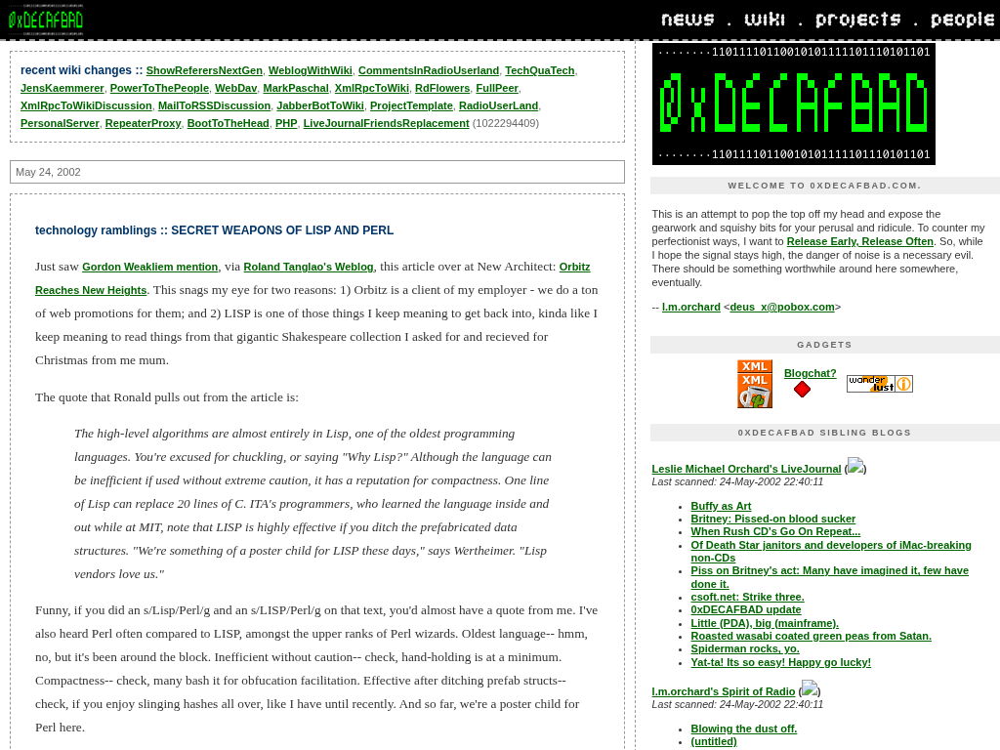
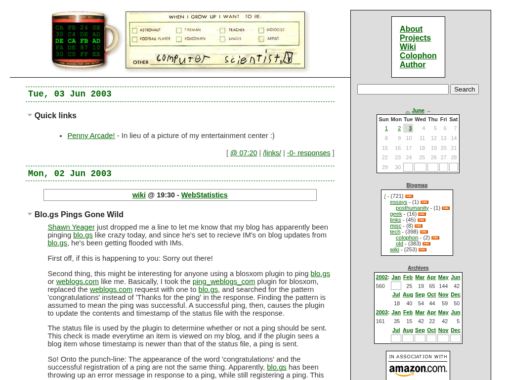
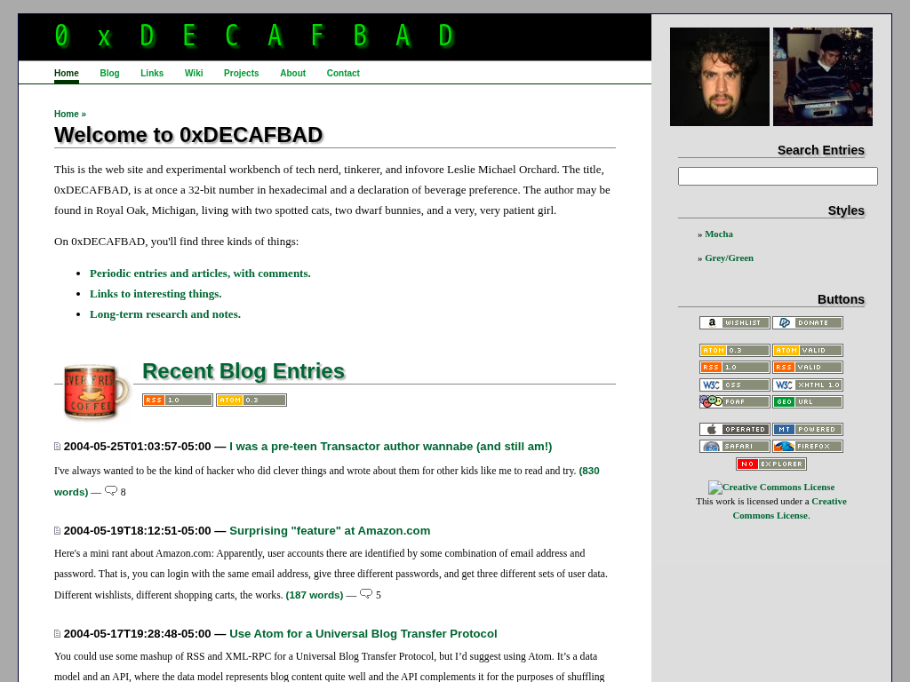
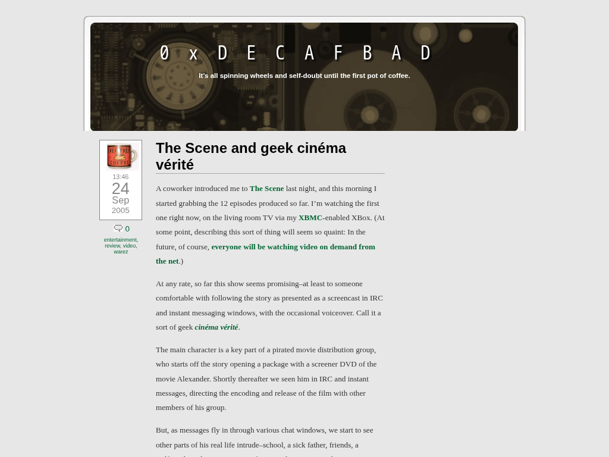
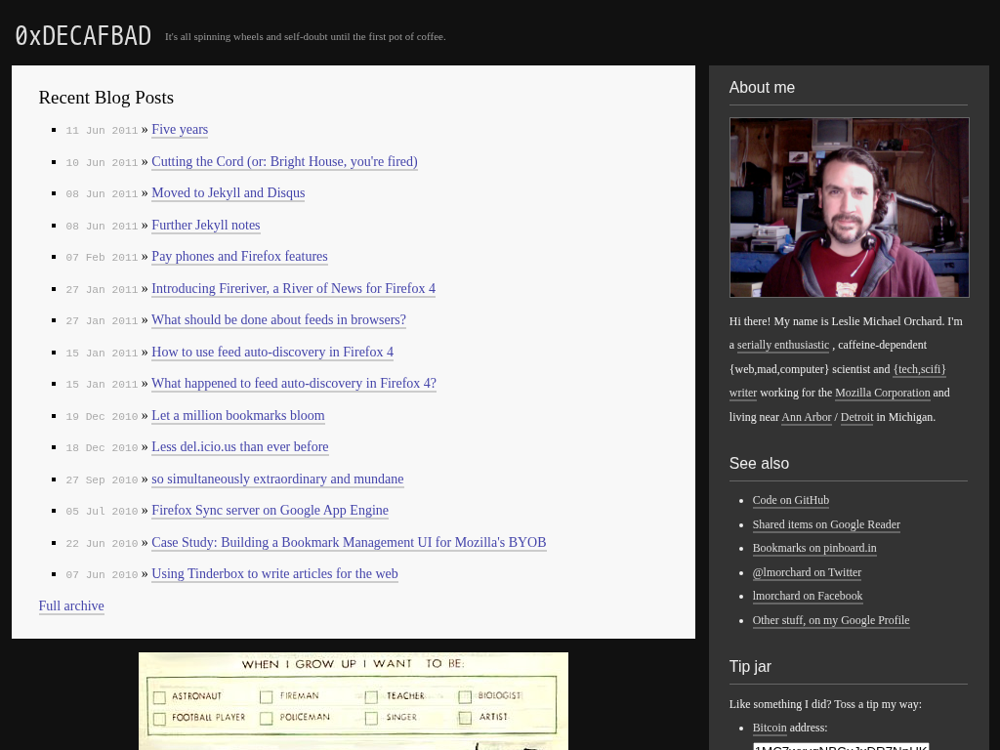
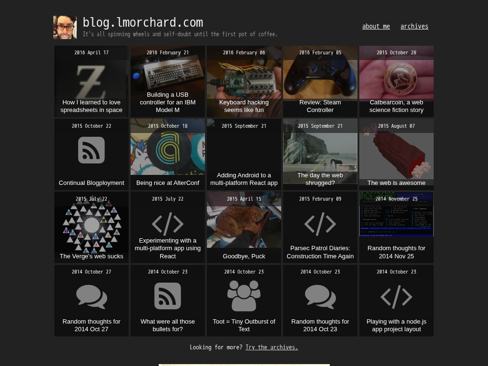
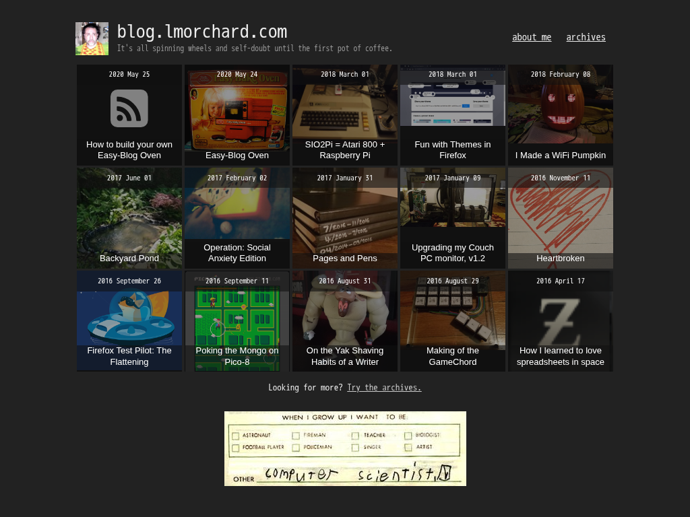

**TL;DR**: A visual tour of nearly twenty-five years of personal web publishing across Movable Type, Blosxom, WordPress, Jekyll, and custom static generators—and how a simple bet on plain Markdown files in git outlived every platform.

<!--more-->

<nav role="navigation" class="table-of-contents"></nav>

*This is Part 1 of a two-part retrospective. In [Part 2: Baking Easy-Blog Oven v2.0 with DecafClaw](/2026/11/17/baking-easy-blog-oven-v2-0-with-decafclaw/), I cover rebuilding the static site generator in Go.*

## An Occupational Hazard

Web developers writing their own blogging tools is an old occupational hazard. But I’ve been at it for almost twenty-five years, so I have more scar tissue than most.

I didn't start this blog on a static generator. I launched `0xDECAFBAD` in [February 2002 on Movable Type](/2002/02/14/ooooac/)—just three months shy of a quarter century ago, which is literally half my life.

<figure>
  
  <figcaption>0xDECAFBAD in May 2002, running on Movable Type (via the Wayback Machine).</figcaption>
</figure>

From the start, I wanted more than just a blog. I had this dream of a unified "WikiLog"—pairing the ephemeral chronological stream with an evergreen garden of ideas. In 2002, that meant running Movable Type side-by-side with TWiki, complete with [over-engineered plugins](/2002/08/19/ooobdd/) that filtered blog posts through XML-RPC to auto-link `WikiWords` to live wiki pages. It was ambitious, but running an open wiki server on the wild web eventually collapsed under spambots and maintenance friction. (The punchline, of course, is that twenty years later, that personal wiki dream won out completely—I now do all my thinking in an Obsidian vault of Markdown files. I just decoupled it: the wiki stays local and quiet, and the blog oven bakes the public stream.)

## The Blosxom Cutover and the Cryptic Slugs (2003)

If you poke around my earliest archive entries today, you'll still see cryptic slugs like [`ooooac`](/2002/02/14/ooooac/), [`ooooba`](/2002/02/18/ooooba/), and [`oooado`](/2002/05/07/oooado/). Those are digital scars: when I got tired of MT moving like a battleship, I rebooted onto Blosxom in March 2003 and declared "[Welcome to 0xDECAFBAD v2.0](/2003/03/01/oooooa/)".

<figure>
  
  <figcaption>0xDECAFBAD in June 2003, running on Blosxom with base-26 slugs and Agent Frank.</figcaption>
</figure>

I wrote a hack to encode Movable Type's numeric database entry IDs into fixed-width base-26 slugs paired with an Apache redirect config so I wouldn't break my permalinks. [Cool URIs don't change](https://www.w3.org/Provider/Style/URI), and all that. I can't remember why I thought this in particular was a good idea. Maybe I thought the numbers were ugly? Maybe they clashed with Blosxom somehow? 

<figure>
  
  <figcaption>0xDECAFBAD in June 2004, featuring the Dive Into Accessibility inspired layout.</figcaption>
</figure>

## The WordPress Detour (2005)

From Blosxom, the posts eventually traveled into WordPress in 2005 (as I recounted in my [September 2005 Colophon](/2005/09/27/colophon/)). 

<figure>
  
  <figcaption>0xDECAFBAD in September 2005, running on WordPress with PHP Markdown and Ultimate Tag Warrior.</figcaption>
</figure>

WordPress solved a lot of publishing friction for a few years, but running a full dynamic, database-backed CMS for personal writing never sat right with me. I didn't want MySQL databases to backup, PHP security patches to chase, or dynamic query overhead for static essays.

## The Bet on Plain Text in Git (2011)

In [June 2011, I moved to Jekyll](/2011/06/08/moved-to-jekyll/). At the time, I wrote something that turned out to be oddly prescient:

> *My writing here is now all stored in individual text files, formatted with Markdown, annotated with YAML metadata, and subject to revision control under git. This combination feels like it has a lot of longevity and potential for survival even beyond this current experiment with Jekyll.*

<figure>
  
  <figcaption>0xDECAFBAD in June 2011, making the jump to Jekyll, GitHub, and a pile of Markdown files.</figcaption>
</figure>

Fifteen years later, that bet on plain Markdown files in git is still paying off. Every CMS, framework, and database engine I used before 2011 has been discarded. The pile of Markdown text files has survived untouched.

## Shifting from 0xDECAFBAD to lmorchard.com (2012)

Around this time, another identity shift happened. In [June 2012, I posted a farewell to decafbad.com titled "303 See Other"](/2012/06/15/303-see-other/) and moved my active blogging over to `blog.lmorchard.com`:

> *`0xDECAFBAD` is not my name. It's a pun I thought was neat, about 12 years ago. I'm not giving up the domain, but I think maybe I should start doing more things with a domain that's closer to what I call myself online and off... it turns out that there's more than one person in the `decafbad` namespace, so I thought I might start drifting closer to the one my Mom gave me. I've grown to like it, despite some misgivings earlier in life.*

I'm still not entirely sure whether giving up the cool hacker handle domain for my actual name was the "right" move, but here we are fourteen years later. Eventually, I reunited the old `decafbad.com` archives with the newer `blog.lmorchard.com` posts so all twenty-four years could live together in one continuous timeline (with redirects preserving the old permalinks, naturally).

<figure>
  
  <figcaption>blog.lmorchard.com in October 2012, running WordPress with the tagline "write like no one's reading."</figcaption>
</figure>

Over the following decade, the visual presentation shifted across several redesigns:

<figure>
  
  <figcaption>blog.lmorchard.com in July 2016, during the Gulp-powered static site era.</figcaption>
</figure>

## The Easy-Blog Oven v1 (2020)

In [May 2020](/2020/05/24/easy-blog-oven/), after outgrowing Jekyll and Gulp, I cobbled together my own Node.js static site generator called the [Easy-Blog Oven](/2020/05/25/diy-easy-blog-oven/). It wasn't an off-the-shelf framework; it was just a few hundred lines of JavaScript gluing together `marked`, `cheerio`, and ES6 template literals. 

<figure>
  
  <figcaption>blog.lmorchard.com in June 2020, debuting Easy-Blog Oven v1 and the canvas maze background.</figcaption>
</figure> 

It worked. It carried my blog for six years, through hundreds of posts, redesigns, and format experiments. But over time, the JavaScript ecosystem tax accumulated: dozens of transitive packages in `node_modules`, deprecation warnings, and an endless barrage of Dependabot alerts. Furthermore, churning through twenty-four years of archive—over 1,400 posts dating back to February 2002—took around 7 to 8 seconds.

It was time for a rewrite.

---

*Continue to [Part 2: Baking Easy-Blog Oven v2.0 with DecafClaw](/2026/11/17/baking-easy-blog-oven-v2-0-with-decafclaw/), where I cover being talked out of Rust, rebuilding the engine in Go, and pairing with an AI agent in an afternoon of flow.*
