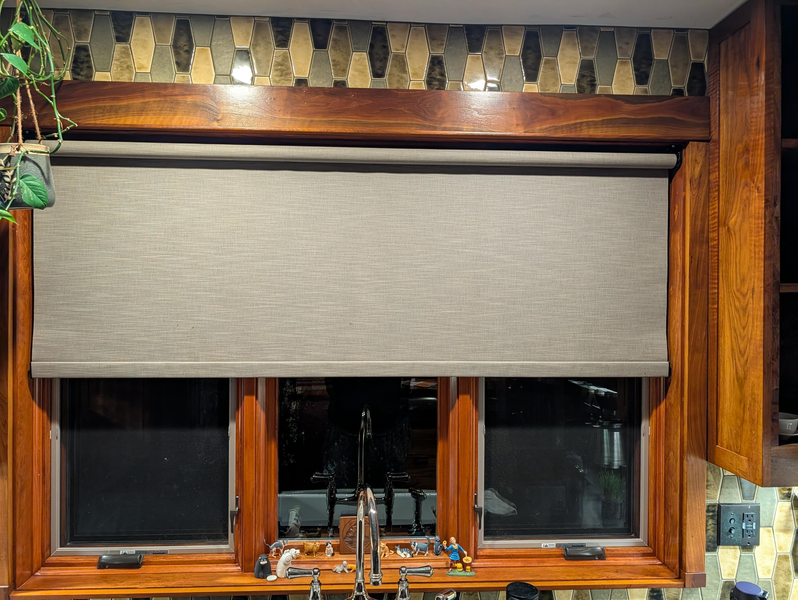
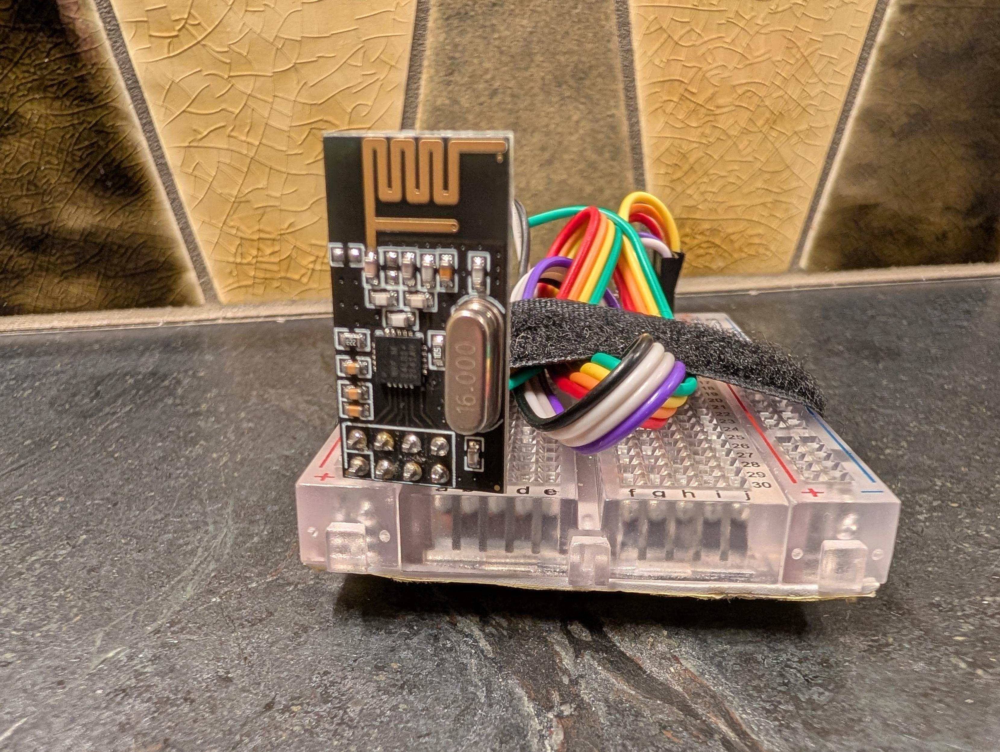
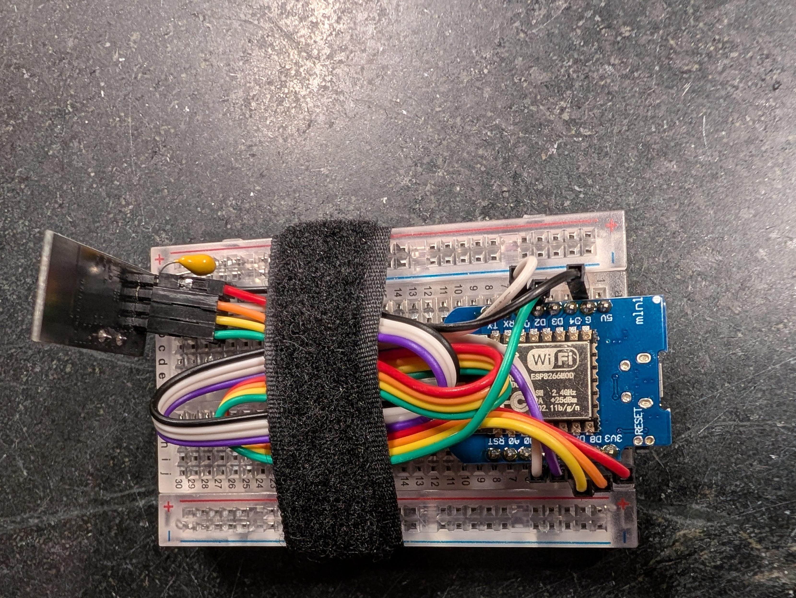
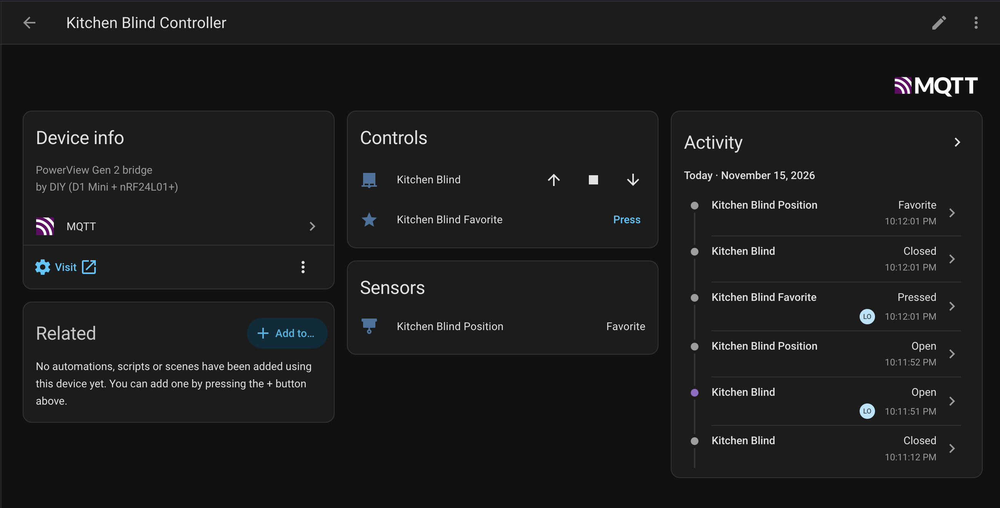
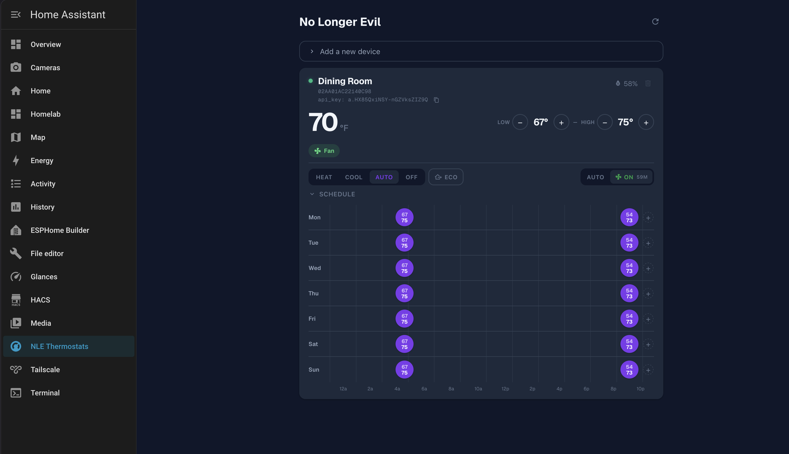
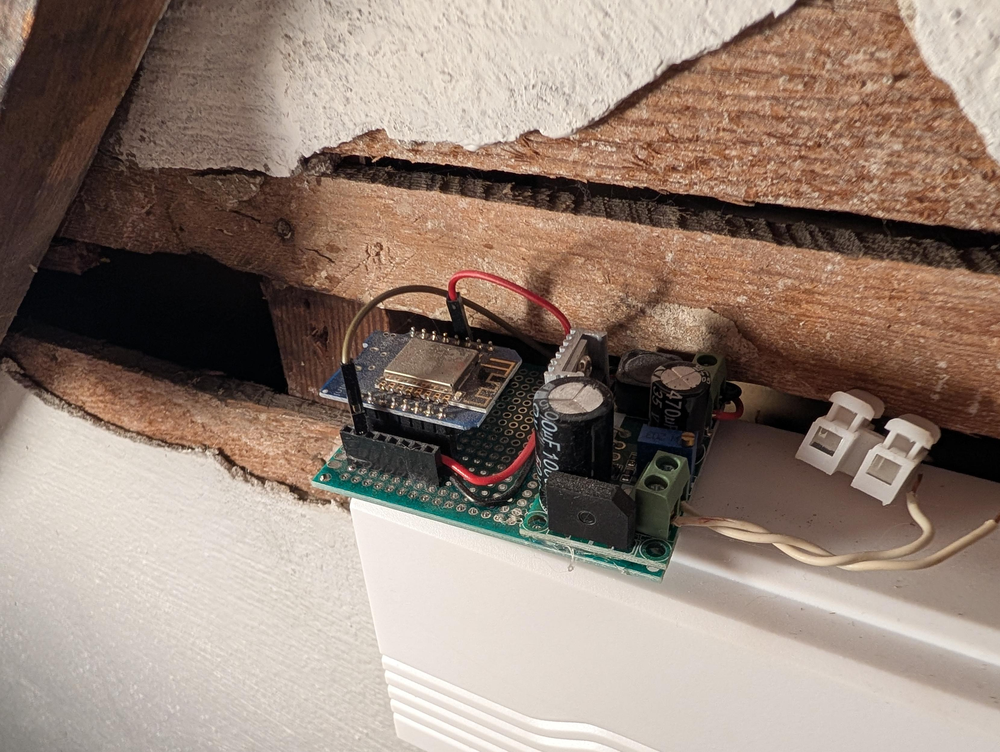
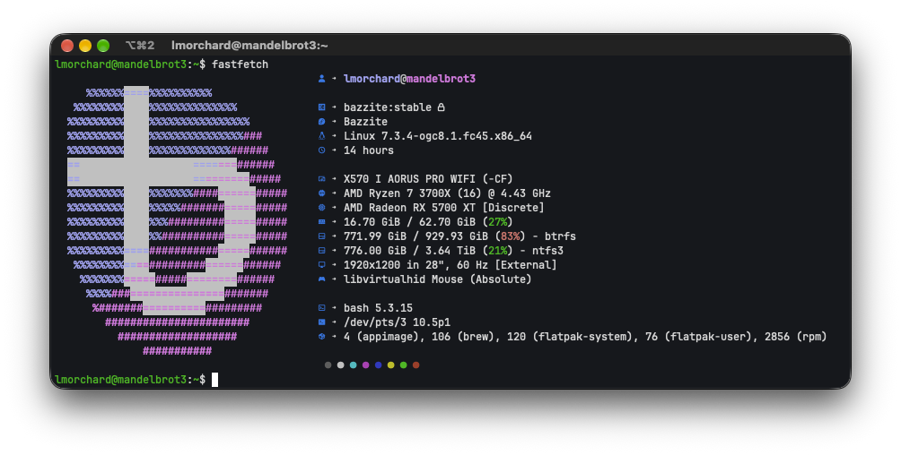

TL;DR: Cloned a proprietary 2.4GHz motorized kitchen blind remote using an nRF24L01+ and brute-force Claude packet sniffing, tortured my basement gaming PC into an anxiety-ridden 4-token-per-second local LLM box, walked 45 minutes across Kalimdor just to level with the cow people in WoW Forever, started a 30mg Vyvanse trial, and bookmarked a mountain of existential essays about AI dismantling engineering jobs.

<!--more-->

<nav role="navigation" class="table-of-contents"></nav>

## The sun was a deadly laser

Another long-standing home automation nemesis was defeated this week.

Our house came with an old motorized HunterDouglas blind over the kitchen window, operated by a little wireless remote clipped to the wall. The kitchen window faces directly into the setting sun, which beams straight through [like a deadly laser](https://masto.hackers.town/@lmorchard/117624668327541026) during spring and summer afternoons. Home Assistant already knows when sunset happens, so for years I've wanted it to lower the blind automatically. 

The trouble was that the original remote was weird, proprietary, and pricey to replace. I didn't want to physically hack the widget. So I finally broke down, [snooped its radio traffic, and cloned it](https://masto.hackers.town/@lmorchard/117624668327541026).

<image-gallery>

</image-gallery>

The hardware was straightforward enough: a cheap nRF24L01+ transceiver module hooked up to an ESP32 with a rat's nest of DuPont jumpers. The protocol reverse engineering, on the other hand, was a slog. I spent several hours staring blankly at packet captures trying to make sense of the framing. 

I'd actually tried this a few years ago and abandoned the project without getting very far. But this time around, I [resorted to having Claude brute-force the problem](https://masto.hackers.town/@lmorchard/117624725955751503), cycling through channel hopping patterns and addresses until the pieces clicked into place. I wrote up the whole sniffing sequence in [a detailed walkthrough on GitHub](https://github.com/lmorchard/kitchen-blinds-controller/blob/main/docs/how-we-found-it.md).

The end result is [kitchen-blinds-controller](https://github.com/lmorchard/kitchen-blinds-controller). It [talks directly to Home Assistant via MQTT](https://masto.hackers.town/@lmorchard/117624680052657451), runs its own web UI as a backup, and supports over-the-air firmware updates:

<image-gallery>

</image-gallery>

It's currently an ugly breadboard contraption sitting on a shelf, but once I'm confident it's reliable over a few weeks, I'll solder it onto perfboard and 3D print a tidy case. (Sure I will. Ask me about this in a year or three.)

## Moar home automation

While I was on a roll liberating household gadgets, I also flashed open-source firmware onto our old Nest thermostat, officially [reconnecting it to Home Assistant](https://masto.hackers.town/@lmorchard/117616476514570058) under the proud label of "[No Longer Evil](https://nolongerevil.com/)". I've been not-so-quietly miffed [for almost exactly one year](https://masto.hackers.town/@lmorchard/115589057507255187) about Google discontinuing and crippling our "smart" thermostat, so it's really cool that the thing is brainy again:

<figure>
  
  <figcaption>The liberated Nest thermostat living in Home Assistant under "No Longer Evil"</figcaption>
</figure>

This also means I will absolutely not be purchasing a new thermostat from Google, knowing that it too would eventually be disposable. Again I say to Google & Nest: [eat a whale.](https://masto.hackers.town/@lmorchard/115589081333075950)

And speaking of projects that linger in the breadboard stage forever: I realized I've had [this perfboard doorbell sensor spying on our chime](https://masto.hackers.town/@lmorchard/117624701405481651) for roughly three years without ever printing an enclosure for it:

<figure>
  
  <figcaption>Three years of "temporary" perfboard spying on the doorbell chime</figcaption>
</figure>

Temporary solutions that work tend to become permanent architecture. Although, in this case, since we replaced the old-school doorbell with a new-school LAN IP camera doorbell, I can just retire this project. [It was a neat exploration into reed switches and voltage stepdown converters, though.](https://old-toots.lmorchard.com/2023/04/30.html?highlight=reed&highlight=switch#anchor-f7d92cc6cabe7b2532a6f2519f4ad162b13d88aa7449ca44ad5342d471bb4e20) 

## GPU-simulated anxiety

Back in August, after thirteen years of having a bulky gaming tower underfoot in the living room, I [banished the PC to the basement](https://blog.lmorchard.com/2026/08/28/w35/) and set up Sunshine to stream games over our local network. Getting the fan noise and heat out of the room was one of the best quality-of-life upgrades of the summer.

Naturally, having an idle x86 box with 64GB of RAM sitting downstairs meant I couldn't resist poking at it. I mean, it's not playing games 24/7, it should pull more of its own weight around here. 

So, this week I decided to [torture the poor thing with local LLMs](https://masto.hackers.town/@lmorchard/117633313643671347).

The catch is its graphics card: an aging AMD GPU with only 8GB of VRAM that only handles modern model weights through deeply inadvisable driver hacks and Vulkan offloading. Running medium-sized models split between VRAM and system memory yielded a blazing, face-melting pace of somewhere between 1 and 8 tokens per second. 

<figure>
  
  <figcaption>mandelbrot3: 64GB of RAM and an 8GB Radeon RX 5700 XT in the basement</figcaption>
</figure>

I ruined a perfectly good gaming PC is what I did. [Look at it. It has anxiety.](https://x.com/jon_snow_420/status/659443020908003328)

At one point, the box [agonizingly composed this message](https://masto.hackers.town/@lmorchard/117633331249122354) one token at a time: *"Please, Les, can we go back to playing [Clive Barker's Hellraiser: Revival](https://store.steampowered.com/app/1551980/Clive_Barkers_Hellraiser_Revival/)? That was much more cozy."*

But, inadvisedly, I remain undeterred. I keep [tinkering with local models](https://masto.hackers.town/@lmorchard/117633469784623045) because I like having an assistant that can answer "what's broken in this stack trace" or "summarize this raw log file" without shipping every piece of personal system telemetry across the open internet. 

I still suspect we're heading toward [a dot-com-scale crash in the broader AI industry](https://blog.lmorchard.com/2026/01/29/miscellanea/). But once the venture capital fog burns off, and assuming we all survive, we'll be left with boring, dependable open-weight models that can do quiet, useful personal tasks on commodity silicon.

## The Mulgore pilgrimage

But, speaking of that gaming PC, it does still sometimes play games. The *World of Warcraft Forever* binge continued unabated this week, mostly because wandering ancient low-level zones with a controller remains an absurdly relaxing way to decompress after work.

At one point, I rolled a fresh troll hunter in Durotar. Then I [spent 45 minutes walking all the way to Mulgore](https://masto.hackers.town/@lmorchard/117635993456453798) just so I could level among the gentle cow people instead of surrounded by red dirt, scorpids, and other trolls. There was really no practical point to this trek, but the change of scenery felt right. I think Mulgore might be the most wholesome, welcoming starting zone in the entire game on either continent.

<figure>
  
  <figcaption>The peaceful rolling grasslands of Mulgore (Thunder Bluff in the distance)</figcaption>
</figure>

That said, I hatched an even more pointlessly complicated leveling scheme. Word reached me that [hunter trainers and tameable fox pets live in Valanaar](https://masto.hackers.town/@lmorchard/117638483687603313), the new skyborne elf territory, and that you can catch a direct blimp there straight out of Mulgore.

I hopped the blimp, enjoyed the scenic cloud views, and [finally touched down in Valanaar](https://masto.hackers.town/@lmorchard/117641685918352204). It was gorgeous. Unfortunately, it turns out [none of the local quest givers will give you the time of day](https://us.forums.blizzard.com/en/wow/t/whats-up-with-zephras-isle/2411003) unless you pony up for the $30 expansion pass. Maybe I'll do that eventually, but not right now.

Sigh. I caught the blimp right back to Mulgore and went back to hunting prairie wolves.

## The smooth baseline

On the domestic and mental health front, Saturday marked my first day on a 30mg trial of Vyvanse.

In therapy beforehand, we spent a session [inventorying my standard catalog of anxieties](https://masto.hackers.town/@lmorchard/117617561355136441): What if it works wonders and then gets hit by a nationwide supply chain shortage? What if it does nothing at all, proving I've just been lazy and making up excuses my entire adult life? What if it turns me into an irritable ball of jitters? And what if it actually helps, leaving me profoundly depressed that I didn't sort this out until after my 50th birthday?

The usual greatest-hits rotation.

The actual first day didn't feel dramatic at all. No lightning bolts, no sudden urge to reorganize my spice rack. But [I had a 12-item todo list for a Saturday](https://masto.hackers.town/@lmorchard/117617516345573387), and I quietly knocked out 9 of them with plenty of time left for pizza dinner date night. That almost never happens, so I'm counting it as a win. By Monday morning, [the crown of my head was tingling](https://masto.hackers.town/@lmorchard/117627836738197855), which I choose to believe means the brain chemistry is adjusting as advertised.

## Job shaped holes

A sizable chunk of my reading queue this week clustered around the uneasy feeling that the ground beneath software engineering is liquefying in real time.

Rach Smith wrote an honest piece about how [the nature of her job has completely changed](https://rachsmith.com/my-job-has-changed), shifting away from the tactile pleasure of writing code toward becoming a full-time spec author and diff auditor for AI agents. In contrast, I think I'm still enjoying my progression into amateur product manager for my own bots, bringing me back to what I wrote about [grief and the AI split](https://blog.lmorchard.com/2026/03/11/grief-and-the-ai-split/) back in March.

Anthropic published data showing [internal AI agent hours overtaking human developer hours](https://www.anthropic.com/research/employment-at-anthropic) while entry-level hiring stalls out. One thing that I hope bodes well for the years I have ahead before retirement: "hiring managers... emphasize autonomy and judgment, relative to technical domain expertise and implementation." I have felt like my experience has let me run autonomously pretty well while I partner with agents.

Sean Goedecke argued that [trying to delegate glue work to LLMs is dangerous](https://www.seangoedecke.com/glue-work-is-still-harmful-in-the-age-of-ai/?ref=sidebar), because human coordination is precisely what keeps software organizations coherent. Over on VioletPixel, there was a refreshing rallying cry that [we still need smart people who give a shit](https://violetpixel.com/blog/2026-11-17-we-need-smart-people-who-give-a-shit/), pushing back against corporate complacency that treats automated output as good enough. 

Add in Steve Yegge on [the collapse of traditional technical interviews](https://yegge.ai/essays/the-last-technical-interview/) and Colossus offering an economic reality check with [AI Will Not Make You Rich](https://colossus.com/article/ai-will-not-make-you-rich/), and you get a pretty vivid snapshot of an industry holding its breath, waiting to see what engineering careers actually look like on the other side. And just how much employers can get away with, now that lots of us are rather desperate.

## Miscellanea

Minnaloushe continues to demonstrate that happiness is nothing more complicated than [an appropriately sized cardboard box](https://masto.hackers.town/@lmorchard/117618884310987291):

<figure>
  
  <figcaption>Minnaloushe testing box tolerances</figcaption>
</figure>

In other domestic breakthroughs, I think I've solved the mystery of persistent hotel smell. If you've ever pulled a workout shirt out of the drawer after three washes and found it still carries that faint, synthetic hotel room fragrance, you know the despair. Vinegar and extra rinse cycles do nothing. 

The only reliable cure I've found is [wearing the shirt during a heavy workout](https://masto.hackers.town/@lmorchard/117633127041041051) and just overwhelmingly asserting my own physical stink dominance over the fabric.

We also caught *Star Wars: The Mandalorian and Grogu* on the television. It's [a thoroughly decent popcorn movie](https://masto.hackers.town/@lmorchard/117616637572177120). No Skywalkers, no Jedi councils, no galaxy-ending superweapons. Just the big guy, the kid, and a bunch of grungy Anzellan mechanics tinkering with engines. 

My only real gripe is that I wish it were an old-school, low-budget 26-episode television season instead of a two-hour film. I miss episodic stories where the main characters just wander from planet to planet solving small problems.

Further nuggets follow:

* **The scale of photolithography**: *The New Yorker* ran a lyrical essay arguing that [computer chips are the most magnificent things humanity has ever made](https://www.newyorker.com/magazine/2026/10/26/computer-chips-are-the-most-magnificent-things-weve-ever-made), paired with an excellent [Vergecast deep dive into the physics and geopolitics of chip fabrication](https://www.theverge.com/podcast/1035666/how-computer-chips-made-vergecast).

* **Chips are almost alien technology**: This reminded me of [this Veritasium video](https://www.youtube.com/watch?v=MiUHjLxm3V0&t=473s) I watched months ago, which I think was one of the first times it really sunk in for me how weird the optics and physics are these days for producing chips.

  <youtube-embed video-id="MiUHjLxm3V0" thumbnail="7fe09be88529.jpg"></youtube-embed>

* **Cruftbox's Muse gadget**: John over at Cruftbox put together [a dedicated desktop assistant hardware build](https://cruftbox.com/2026/11/16/building-my-own-muse-gadget/) using a Waveshare touchscreen. His tinkerings have been prodding me to do more of my own tinkerings, lately.

* **Self-hosted 3D printing**: Prusa open-sourced [a local, self-hosted server version of Prusa Connect](https://github.com/prusa3d/prusa-connect), freeing printer monitoring and queue management from cloud dependencies. Kinda neat, and I'm tempted to stick it in my homelab, but I'm not terribly unhappy using their cloud. (That doesn't seem like me. 🤔)

* **Petit Computer and SmileBASIC homebrew**: Watched [an hour-long retrospective](https://www.youtube.com/watch?v=aS1Lcspp-Nc) on Petit Computer and Scratch on handheld consoles. The timing was uncanny, given reports of [a Nintendo Switch 2 jailbreak](https://masto.hackers.town/@lmorchard/117635545777151073) that once again exploits SmileBASIC, echoing the classic vulnerabilities on the [Nintendo 3DS](https://www.nintendolife.com/news/2016/07/smilebasic_gets_taken_down_from_the_3ds_eshop_due_to_a_homebrew_exploit) and [Nintendo DSi](https://github.com/zoogie/petit-compwner).

  <youtube-embed video-id="aS1Lcspp-Nc" thumbnail="d4d16070f704.jpg"></youtube-embed>

* **Wasm kernel theater**: Someone compiled [a real Linux kernel to WebAssembly](https://github.com/pithings/unkernel) that boots to a responsive shell in your browser tab in under a second. Naturally, someone else decided that wasn't unhinged enough and built [Tabernetes: a full Kubernetes cluster control plane in a browser tab](https://jkroepke.de/tabernetes/).

* **Finding mystery beeps**: Simon Willison documented [using Claude to locate an elusive domestic beeping device](https://simonwillison.net/2026/Nov/9/mysterious-beeps/), which resonated strongly with my radio sniffing adventures this week.

* **Prompt reconstruction attacks**: A fascinating security paper on [Previous-Token Prediction (PTP)](https://arxiv.org/abs/2607.29378) showing how language model output can be run backward to recover system prompts almost verbatim. I haven't finished reading the paper, so I'm curious how practical or reliable this is?

* **Vectrex Mastery**: Roger Boesch released [a comprehensive digital book on Vectrex 6809 assembly and C programming](https://rogerboeschgames.gumroad.com/l/vectrex-mastery) for vector graphics game cartridges.

* **AV routing overkill**: The [Scalable Video Switch](https://scalablevideoswitch.com/) is an ambitious modular switching system built for retro console collectors, scaling up to 32 video inputs.

* **Steam games on macOS**: [Bridgeplay](https://bridgeplay.dev/) lets Windows-only Steam games launch seamlessly on Apple Silicon from directly within the native macOS Steam client. This feels a lot like the sort of thing I do with Proton in Bazzite Linux. And, in fact, [Bridgeplay is a fork of NotProton](https://github.com/raymondchins/Bridgeplay)—which I hadn't heard of until just now!

* **Tiling window management on Mac**: [OmniWM brings Niri and Hyprland-style scrolling columns to macOS](https://omniwm.app/), complete with Ghostty dropdown terminal integration.

* **Friday cocktail hour**: Tried the [Empyrean](https://cocktailvirgin.blogspot.com/2026/11/empyrean.html), a moody drink that balances Sazerac rye whiskey, mezcal, Ramazzotti amaro, and maraschino liqueur.

